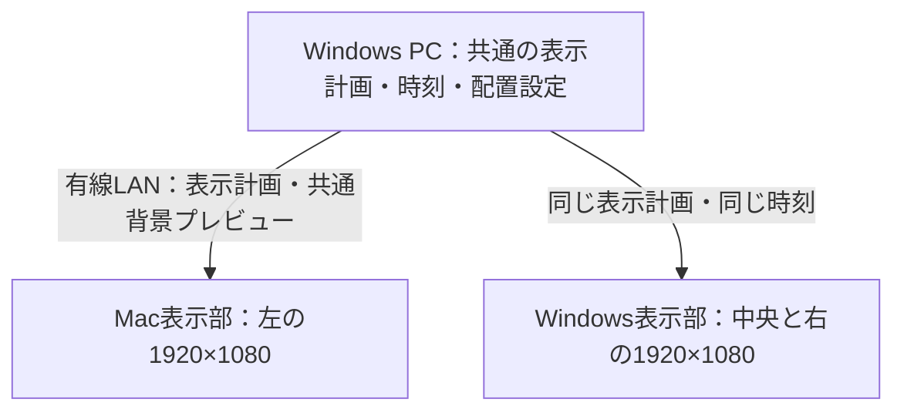

# Mac + Windows：3画面同期 Photo Wall 計画

作成日: 2026-10-14。更新日: 2026-10-17。

Windows内のマルチディスプレイ表示を実装済み。対象画面の複数選択、ドラッグと数値による配置、共通キャンバスの写真・時計・背景、格子テスト、未接続領域の保持に対応する。通信・ペアリング・Macとの同期、同期時刻による配置プレビューの切り替えは未実装。以下の3画面同期計画のうち、Windows単体で成立する部分を先行した。

開発の優先順位は **単体で使えるmacOS版の完成 → Windowsの2画面対応と配置設定 → 2台・3画面の同期** とする。最小のMac表示部だけを作って同期へ進む計画から変更した。

## 1. 確定した要件

| 項目 | 内容 |
|---|---|
| PC | Mac 1台、Windows 1台 |
| 画面 | 左からMac、Windows、Windows |
| 解像度・サイズ | 全画面1920×1080、24インチ |
| ネットワーク | 2台とも同じLANに有線接続 |
| 写真 | 両PCへ同じ写真ファイルをコピーできる |
| 表示 | 3画面を1つのキャンバスとして、写真・ギャラリーが画面の境界をまたいで動く |
| 配置設定 | マルチディスプレイ設定のように画面をドラッグして配置を変更できる |
| 操作感 | 現在のPhoto Wallのシャッフル・スクロール・パン・顔位置調整・動的背景を発展させる |

初期配置は5760×1080。画面を上下へ動かす、間隔を設定する、回転させると外接キャンバスの寸法が変わる。複数枚を並べる構成も含み、「常に1枚の写真を全幅へ引き伸ばす」という制約は設けない。

## 2. 全体構成

以下はmacOS単体版の完成後に追加する同期モードの構成。macOS単体版は自分で写真を選択し、ネットワーク接続やWindowsの起動を必要とせず再生できるようにする。

Windowsを初期のコーディネーター（進行役）にする。写真の抽選・配置・顔位置・動き・再生時刻をここで決定し、MacとWindowsの表示部へ共通の表示計画を渡す。Windows自身も同じ計画に従う。

| 画面 | 初期の共通座標 | 描画する領域 |
|---|---|---|
| Mac・左 | (0, 0) | x=0〜1920、y=0〜1080 |
| Windows・中央 | (1920, 0) | x=1920〜3840、y=0〜1080 |
| Windows・右 | (3840, 0) | x=3840〜5760、y=0〜1080 |

各画面は共通キャンバスの担当領域を切り出す。画面をまたぐ写真の拡大率と移動量は全画面で共通にする。OSのローカルなディスプレイ座標と、このアプリの共通座標は別に管理する。

写真本体は各PCのローカルファイルを使用する。主な通信は表示計画・時刻合わせ・状態通知。動的背景用に小さな共通プレビューも送る。全画面映像の転送やクラウドサーバーは初期構成に含めない。

## 3. 画面配置を設定する画面

Windows版のDisplay設定へ「同期ウォール」を追加し、初期の設定窓口とする。Mac側は参加・写真フォルダー選択・接続状態・画面番号表示を備える。

- ペアリングした2台から画面のID・名前・画素数・倍率・リフレッシュレートを取得する。
- 画面カードに「Mac / 1」「Windows / 2」「Windows / 3」を表示し、実画面にも番号を一時表示できる。
- ドラッグによる並べ替え、上下位置の調整、端や中心へのスナップ、座標の数値入力を用意する。
- 拡張キャンバスで使う画面を選択する。検出された全画面を自動で参加させない。
- 画面間の隙間・ベゼル幅を設定できるようにする。初期値は0。ベゼル補正を有効にすると、その幅に相当する画像部分が物理的な枠の裏へ隠れる配置にする。
- 「テストパターン」で格子・斜線・円を3画面にまたいで表示し、写真を使う前に位置と倍率を合わせる。
- 配置は一時プレビュー後に適用できる。適用は全端末共通の時刻・配置バージョンで切り替える。

初期は同じ24インチ・FHDとして1:1の画素対応を採用する。OSのUI倍率によって写真の大きさが変わらないよう、表示部で実画素へ変換する。Macのポイント座標とピクセル座標の変換にはAppKitの変換APIを使う。[Apple公式](https://developer.apple.com/documentation/appkit/nsscreen/convertrecttobacking(_:))

将来、サイズや画素密度の異なる画面を加える場合は、実寸を基準にした倍率調整を追加する。現在の3画面をつなぐために必須の範囲は、配置・上下位置・隙間・OS倍率の補正とする。

## 4. 写真と表示計画

### 写真の照合

ファイル内容のSHA-256を写真IDとし、各PCでIDからローカルパスを引く。MacとWindowsでパスやファイル名の表現が異なっても同じ写真として扱える。ハッシュは初回と変更時に計算し、キャッシュする。

初期版では、両PCに存在し、両PCでデコードできる写真の共通集合を選択対象にする。追加コピー中・不足・破損・対応していない形式を区別して表示する。選択した写真が片方で読み込めない場合、進行役が計画全体を差し替える。各画面が独自に別の写真へ交換する動作は同期モードでは行わない。

EXIF回転・画像寸法・色空間の扱いを共通化する。最初はJPEG/PNGを基準に検証し、WebP/HEICは両PCのデコード準備完了を確認してから有効にする。写真のアップロードや自動コピーは初期版に含めない。

### 共通の表示計画

抽選結果を具体的なデータにして配布する。乱数シードだけに依存すると、言語・抽選履歴・ファイル順の違いで結果が分かれるため、次を確定して送る。

- プロトコル・セッション・計画・配置のバージョンとID。
- 写真ID、EXIF適用後の寸法、表示順。
- 共通座標での写真の矩形、切り取り、ズーム中心、パンの始点・終点。
- 開始時刻、継続時間、フェード曲線、各写真の交換時刻。
- 必要な顔領域・優先位置。初期はWindowsの顔検出結果を基準にし、Mac側で別の検出結果へ置き換えない。
- スクロールで後続する写真と、入れ替え後の配置。
- 背景プレビューの対応時刻・ID・表示パラメーター。

3画面全体のGalleryと横スクロールを主な表示にする。1枚の全幅パン・Zoomも対応するが、5760px幅では写真の上下が大きく切れたり、元解像度を超えたりする。写真の縦横比・顔・許容拡大率からモードを選ぶ。現在の縦写真中心のライブラリーでは、複数枚のギャラリーが適している。

## 5. 時刻と動きの同期

「開始メッセージが届いたら再生」ではなく、準備完了後に将来の共通開始時刻を決める。

1. 接続時に往復通信を複数回測り、遅延と時刻差を推定する。遅延の小さいサンプルを使い、接続後も定期的に更新する。
2. システムの日付時刻を変更せず、各端末の単調増加時計を進行役のセッション時刻へ対応付ける。時刻補正で写真が急に跳ばないようにする。
3. 進行役が次の計画を先に送り、両PCが画像のデコード・必要なGPU準備を終えてReadyを返す。
4. 両PCの準備完了後、例として1〜2秒先の開始時刻を通知する。間に合わなければ現在の構成を延長し、開始を再設定する。
5. 各画面は共通時刻から現在の進捗を評価する。フレームを落としても、次の描画ではその時刻の位置へ追いつく。
6. 初期は次の構成とスクロール用の後続写真を先読みする。送信順・古い計画・再接続時のセッション混同をIDで防ぐ。

時刻差・遅延の推定には、4タイムスタンプを使うNTPの考え方を参考にする。OSのNTP設定を変更するものでも、NTPサーバーを必須にするものでもない。[RFC 5905 §8](https://datatracker.ietf.org/doc/html/rfc5905#section-8)

通信はペアリングした端末間の認証付きWebSocketを候補とする。初回は手動IP・ペアリングコードで接続できるようにし、自動検出は後段で追加する。初期版の進行役はWindows固定とし、自動的な進行役交代は含めない。

### 同期精度の範囲

共通時刻で同じ動きを計算することと、3画面が同じ瞬間に走査を始めることは別の問題。各ディスプレイ・GPU・OSの描画タイミングは独立している。AppleのDisplayLinkも更新時刻についてbest effortであり、DXGIの通常の表示同期も出力単位で扱われる。[Apple公式](https://developer.apple.com/documentation/quartzcore/cametaldisplaylink/preferredframeraterange)、[Microsoft公式](https://learn.microsoft.com/en-us/windows/win32/api/dxgi1_2/nf-dxgi1_2-idxgiswapchain1-present1)

初期の検証目標は、通常の有線LANで共通時刻の推定差を95%点で5ms以内に抑え、実画面の表示差を60Hz換算で1〜2フレーム以内に収めること。達成済みの性能値や保証ではない。120px/秒なら33msの差は約4pxになるため、境界を通過する写真で見え方も確認する。完全な走査同期が必須と分かった場合は、専用の同期機材や出力構成を含めた再検討が必要になる。

リフレッシュレートはまだ未確認。試作時には可能なら全画面60Hzにそろえて評価し、その後に混在レートを検証する。

## 6. 動的背景も3画面でつなぐ

現在のGlassBackgroundは各ウィンドウで見えている写真を取得してぼかす方式。これを3画面で独立に実行すると、境界で参照する写真・ぼかしの範囲・更新時刻・直前の混合結果が違い、色の継ぎ目ができる。

同期版では進行役が、共通の表示計画から指定時刻の全キャンバスの小さな背景プレビューを生成し、全表示部へ先送りする。例として256×48pxの全体プレビューを使う。全画面をまとめてぼかし、色空間と暗幕も統一する。各端末は同じプレビュー列を同じ時刻で補間し、担当領域を切り出す。

これによりパン・Galleryの個別交換・横スクロールに背景が追従し、画面の境界でも同じ背景の続きになる。背景の更新が一時的に遅れた場合は最後の共通プレビューを維持し、写真本体の描画を待たせない。再接続時は背景の現在値も含めたスナップショットから復帰する。

## 7. OSごとの表示部と既存コードへの変更

| 部分 | 方針 |
|---|---|
| Windowsの写真選択・計算 | 既存Coreを基に全キャンバスの計画を作る。画面ごとに別の抽選を行わない |
| Windowsの画面接続 | DesktopWindowHost等を画面ごとに持つ。1台のPCで2画面へ表示する |
| Windowsの再生時計 | 各Storyboardの独立した開始時刻への依存を改め、共通時刻へ追従させる |
| Windowsの描画方式 | まずWPFで検証。時刻追従・提示遅延・負荷が基準を満たさない場合に、描画部のDirect3D化を判断する |
| macOS | まずSwift + AppKitで常駐、SwiftUIで設定、Metalで画像表示する単体アプリを完成させる。その後、同期モードでWindowsと同じ計画を受け取る |
| Macの描画同期 | DisplayLinkの提示予定時刻を共通セッション時刻へ対応させる。[Apple公式](https://developer.apple.com/documentation/quartzcore/cametaldisplaylink) |
| 背景 | 端末ごとの背景取得を、共通の背景プレビューへ置き換える |
| 通常版 | 現在の単一画面モードを残し、「同期ウォール」を別の動作モードとして追加する |

共通化の中心はバージョン付きJSONの表示計画と、その計画を時刻から評価する仕様にする。同じJSON・同じ時刻で位置と透明度が同じになるテスト用データをC#とSwiftで共有する。C#/.NETをMacへ埋め込むことは初期版の必須条件にしない。

MacとXcodeでの実機開発・動作確認が必要。macOSバージョン、Macのチップ、Xcode環境は実装着手前に確認する。

## 8. 操作・遮蔽・切断の扱い

| 状況 | 初期版の動作方針 |
|---|---|
| 再生・一時停止・次の構成 | 進行役に集約し、将来の共通時刻で全画面へ適用する |
| 1画面がアプリで覆われる | その画面の描画負荷を下げる。共通の再生時刻は進め、再表示時に現在位置へ戻る |
| Macだけがスリープ・切断 | Windowsは受信・確定済みの計画を継続。Macの領域を詰めて画面全体の配置を変えない |
| 進行役のWindowsが停止 | Macは確定済み計画の範囲まで再生し、その後は最後の表示を維持する。自動交代はしない |
| 再接続 | 配置・計画・時計・背景を再取得し、準備できた共通の時刻で復帰する |
| 写真不足・デコード失敗 | 同期モードでは進行役が全体の計画を差し替える。問題の写真と端末を設定に表示する |
| 画面の抜き差し | 画面IDを保持し、配置を勝手に詰めない。参加復帰はレイアウトの検証後に行う |
| Dock・タスクバー | OSごとの表示・復元処理として管理する。全体をつなぐため、隠した状態と表示した状態の両方で検証する |

通信断では全端末への同時通知を保証できないため、一時的な不一致は起こり得る。切断中の状態を「同期済み」と表示せず、再接続時に再同期する。

現在のWindows版は画面遮蔽時に再生時間も止める。同期モードでは「ローカルな描画休止」と「全体の一時停止」を分離する必要がある。

## 9. 実装の順序と完了条件

| 段階 | 作るもの | 次へ進む条件 |
|---|---|---|
| 0. macOS単体版を完成 | 写真フォルダー選択、対象画面選択、デスクトップ背面表示、メニューバー常駐、Gallery・横スクロール・パン・Zoom・顔位置調整・動的背景・設定保存 | Windowsを起動していなくてもMacだけで使え、Dock・Spaces・スリープ復帰を含む実機検証が通る |
| 1. 3画面の接続と配置 | 完成したMac版の同期参加機能、Windowsの2画面表示、画面検出、番号表示、ドラッグ配置、格子パターン | 5760×1080の写真と格子が3画面で正しい位置・倍率につながる |
| 2. 時計とパンの同期 | ペアリング、共通時計、具体的な表示計画、Readyと予約開始、時刻からの位置計算 | 同じ写真・移動パターンが境界をまたいで動き、時刻差と提示差を測定できる。描画方式をここで判断する |
| 3. ギャラリーとシャッフル | 写真ID照合、先読み、横スクロール、従来Galleryの個別交換、フェード、顔位置 | 新しい写真が3画面をまたいで流れ、各画面が独自に写真や配置を変えない |
| 4. 共通の動的背景 | 全体プレビュー生成・先送り・時刻補間・領域切り出し | 写真交換や移動中も背景がつながり、境界に固定の色の段差が出ない |
| 5. 常駐と復旧 | 背面表示、Dock/タスクバー、遮蔽時の休止、切断・スリープ・再接続、設定保存 | 片方の操作や復帰で進行がずれず、単一画面モードも維持される |

最初にmacOS単体版の背面表示・滑らかな描画・常駐と復旧を確認する。単体版を完成させた後、同期段階の試作では画面配置と境界を通る動きの同期精度を優先し、その上へ各演出を同期させる。

### macOS単体版の進め方

1. **表示の土台**: 対象のFHD画面へ写真1枚を背面表示し、通常アプリ・デスクトップアイコン・Dock・Spacesとの共存をMac実機で確認する。
2. **写真ライブラリーと動き**: フォルダー選択、EXIF対応、先読み・キャッシュ、シャッフル、従来Galleryと横スクロール、縦横パン、Zoomを実装する。画面更新に合わせた描画の滑らかさと負荷を確認する。
3. **見せ方**: Mac単体ではVisionの顔検出を使って表示位置を調整し、表示中の写真へ追従する動的なぼかし背景を追加する。写真のフチぼかしは追加しない。
4. **日常利用**: 設定保存、メニューバーからの開始・停止・一時停止・次の構成、ログ、スリープ復帰、画面接続変更、連続運転を検証する。

表示計画の作成、時刻からの状態計算、画面への描画は分けておく。単体版のローカルな写真選択と時計を、後から同期モードの共通計画と時計へ切り替えられる構成にする。同期通信・ペアリング・他PCの写真照合は、この段階の完成条件に含めない。

## 10. 検証計画と未確定事項

- 幾何: 左右をまたぐ格子・斜線・円で、座標と倍率を確認する。ベゼル補正を無効にした同一解像度の仮想画像では、共通座標の対応を1px以内で検証する。
- 時刻: 往復遅延・時刻差推定・ドリフト・計画IDを記録する。単なるRenderingイベントの回数を提示fpsとはみなさない。
- 実画面: 共通の時刻カウンターと境界を通るバーを表示し、可能なら高フレームレートのカメラで3画面を同時撮影する。ログ上の同期と実際の提示差を区別する。
- 画像: EXIF、同じファイルの異なるローカルパス、ファイル不足、コピー途中、非対応形式、顔が境界付近にある場合を確認する。
- 背景: 画面外から入ってくる写真・フェード・再接続で、共通背景が正しい時刻へ追従することを確認する。
- 復旧: MacとWindowsそれぞれのスリープ、ネットワーク切断、進行役の再起動、画面の抜き差し、全画面アプリからの復帰を確認する。
- 連続運転: 8時間以上で境界のずれが増えないこと、メモリ・CPU・GPU負荷を確認する。

実装着手前に確認する事項は、MacのOS・チップ・Xcode環境、3画面の実際のHz、上下位置とベゼル補正の初期値。開発期間は、Mac側の背面表示とWPF側の同期試作の結果を見て見積もる。

初期版に含めないもの: 写真ファイルの自動配信、クラウド中継、自動的な進行役交代、走査タイミングまで保証する専用同期、色・輝度の自動キャリブレーション。これらは3画面のPhoto Wallが成立した後に必要性を判断する。
