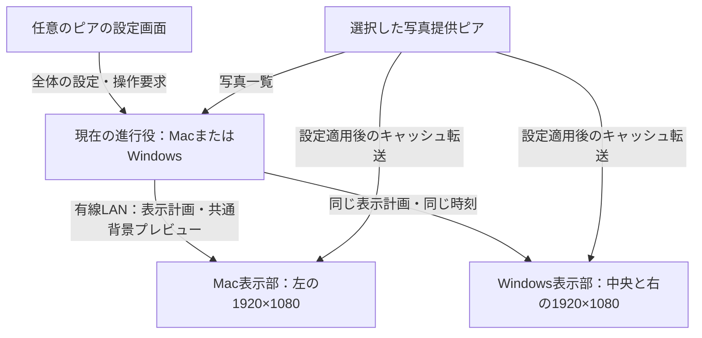

# Mac + Windows：3画面同期 Photo Wall 計画

作成日: 2026-10-14。更新日: 2026-10-18。

2026-10-18にネットワークの前提を変更した。進行役は自動選出・障害時の自動引継ぎに対応し、任意の接続済みピアから全体を操作する。設定適用時に原寸写真と顔メタデータをバックグラウンド転送し、通信中・保存時とも暗号化する。キャッシュは同じ提供ピアのソース再適用で削除・更新し、有効期限は14日。切断後も残存ピアは同期を続け、孤立側だけが直前モードを1分繰り返してスタンドアロンへ移る。オンライン待受・自動検出・受信側確認なしの接続も初期設計に含める。具体的な設計は[ピア間ネットワーク機能の設計](NETWORK-PEER-DESIGN.md)を参照。

Windows内のマルチディスプレイ表示を実装済み。対象画面の複数選択、ドラッグと数値による配置、共通キャンバスの写真・時計・背景、格子テスト、未接続領域の保持に対応する。通信・ペアリング・Macとの同期、同期時刻による配置プレビューの切り替えは未実装。以下の3画面同期計画のうち、Windows単体で成立する部分を先行した。

次は[Macへの差分引き継ぎ](../macos/WINDOWS_DELTA_HANDOVER.md)に従い、画面グループ・設定UI・即時テスト表示・顔によるパン方向をMac単体へ反映する。その後にPC間同期へ進む。

Windowsでは表示モードごとにスパン／画面単位を選択できる。顔の境界対策はスパンを維持したGallery・縦Panの配置調整として実装し、顔対策だけのためにグループを分割しない。将来の共通表示計画も、グループのモード・時刻と、スパンまたは画面別の描画計画を区別して扱う。

開発の優先順位は **単体で使えるmacOS版の完成 → Windowsの2画面対応と配置設定 → 2台・3画面の同期** とする。最小のMac表示部だけを作って同期へ進む計画から変更した。

## 1. 確定した要件

| 項目 | 内容 |
|---|---|
| PC | Mac 1台、Windows 1台 |
| 画面 | 左からMac、Windows、Windows |
| 解像度・サイズ | 全画面1920×1080、24インチ |
| ネットワーク | 2台とも同じLANに有線接続 |
| 写真 | 設定適用時に選択した接続ピアからバックグラウンド転送・暗号化キャッシュ。全台への手動コピーは不要 |
| キャッシュ | 原寸・元の画質、同じ提供ピアのソース再適用で削除・更新、有効期限14日。読み込み時に顔メタデータを生成して同期 |
| 接続 | オンラインモード有効で待受・検出。候補を選んで接続し、受信側は確認なしで受入 |
| 役割・操作 | 進行役は動的に交代可能。任意の許可済みピアから全体を設定・操作 |
| グループ管理 | 全ピアの画面を既存の共通グループ管理へ合流。各画面はピアをまたぐグループまたは単独表示を選択 |
| 表示 | 3画面を1つのキャンバスとして、写真・ギャラリーが画面の境界をまたいで動く |
| 配置設定 | マルチディスプレイ設定のように画面をドラッグして配置を変更できる |
| 操作感 | 現在のPhoto Wallのシャッフル・スクロール・パン・顔位置調整・動的背景を発展させる |

初期配置は5760×1080。画面を上下へ動かす、間隔を設定する、回転させると外接キャンバスの寸法が変わる。複数枚を並べる構成も含み、「常に1枚の写真を全幅へ引き伸ばす」という制約は設けない。

## 2. 全体構成

以下はmacOS単体版の完成後に追加する同期モードの構成。macOS単体版は自分で写真を選択し、ネットワーク接続やWindowsの起動を必要とせず再生できるようにする。

ウォールごとに、接続ピアからコーディネーター（進行役）を自動で選ぶ。Mac／Windowsのどちらも担当でき、通常接続中の交代と停止時の自動引継ぎに対応する。写真の抽選・配置・顔メタデータを使った位置調整・動き・再生時刻を進行役で決定し、各表示部へ共通の表示計画を渡す。進行役自身の表示部も同じ計画に従う。全体の設定操作と写真提供元は、進行役から独立させる。

| 画面 | 初期の共通座標 | 描画する領域 |
|---|---|---|
| Mac・左 | (0, 0) | x=0〜1920、y=0〜1080 |
| Windows・中央 | (1920, 0) | x=1920〜3840、y=0〜1080 |
| Windows・右 | (3840, 0) | x=3840〜5760、y=0〜1080 |

各画面は共通キャンバスの担当領域を切り出す。画面をまたぐ写真の拡大率と移動量は全画面で共通にする。OSのローカルなディスプレイ座標と、このアプリの共通座標は別に管理する。

上記は3画面を同じグループへ入れた例。管理範囲には全ピアの画面をまとめ、既存の「使用ディスプレイ」「画面グルーピング」で共通グループへの所属または単独表示を選ぶ。同じグループなら所有ピアをまたいで共通キャンバス・計画・時計・背景を共有する。別グループと単独画面は独立再生とし、同じピア内の画面も別々に所属できる。モード別の「ディスプレイごとに表示」はグループ内の描画方法であり、単独表示への所属変更とは区別する。

写真ソースの設定を適用した時点で、選択した提供ピアから利用ピアへのキャッシュ転送をバックグラウンドで開始する。通信は暗号化・認証し、受信側の再生用キャッシュも暗号化して保存する。同じ画像がローカルにあれば再転送を省く。通信は写真取得・表示計画・時刻合わせ・設定共有・状態通知・小さな共通背景プレビューを扱う。全画面映像の転送やクラウドサーバーは初期構成に含めない。

## 3. 画面配置を設定する画面

Mac／Windowsの設定へ「同期ウォール」を追加し、どちらからでも全体の画面配置・写真ソース・再生設定・進行役の交代を操作できるようにする。全体設定は進行役へ変更要求を送り、確定したバージョンを共有する。同時編集の競合を検出し、古いドラフトで黙って上書きしない。フォルダー・PhotoKitのOS権限は所有端末で取得する。

- 接続したピアから画面のID・名前・画素数・倍率・リフレッシュレートを取得する。
- 画面カードに「Mac / 1」「Windows / 2」「Windows / 3」を表示し、実画面にも番号を一時表示できる。
- ドラッグによる並べ替え、上下位置の調整、端や中心へのスナップ、座標の数値入力を用意する。
- 拡張キャンバスで使う画面を選択する。検出された全画面を自動で参加させない。
- 全ピアの画面を共通一覧へ表示し、既存または新しい共通グループへの所属・単独表示を設定する。ピアが増えても端末専用のグループへ自動分割しない。配置はグループ単位で編集する。
- 画面間の隙間・ベゼル幅を設定できるようにする。初期値は0。ベゼル補正を有効にすると、その幅に相当する画像部分が物理的な枠の裏へ隠れる配置にする。
- 「テストパターン」で格子・斜線・円を3画面にまたいで表示し、写真を使う前に位置と倍率を合わせる。
- 配置は一時プレビュー後に適用できる。適用は全端末共通の時刻・配置バージョンで切り替える。

初期は同じ24インチ・FHDとして1:1の画素対応を採用する。OSのUI倍率によって写真の大きさが変わらないよう、表示部で実画素へ変換する。Macのポイント座標とピクセル座標の変換にはAppKitの変換APIを使う。[Apple公式](https://developer.apple.com/documentation/appkit/nsscreen/convertrecttobacking(_:))

将来、サイズや画素密度の異なる画面を加える場合は、実寸を基準にした倍率調整を追加する。現在の3画面をつなぐために必須の範囲は、配置・上下位置・隙間・OS倍率の補正とする。

## 4. 写真と表示計画

### 写真の照合

転送する確定済み画像の内容のSHA-256を画像IDとし、提供元と受信キャッシュを照合する。通常ファイルは元の内容を変更せず、PhotoKitの編集済み画像などは原寸・最高品質の転送用データを確定してからハッシュする。縮小や非可逆な再圧縮を行わない。画像IDとは別に提供ピア・ソース・キャッシュ世代を記録し、同じ内容でも明示的な更新を区別する。

選択した公開ソースの写真を対象に、設定適用でキャッシュジョブを開始する。ドラフト選択時には写真本体を転送しない。Macの写真を選んだ場合はMacが転送用画像を用意し、Windows等の利用ピアが暗号化保存する。必要な表示部でキャッシュ・デコードの準備ができた写真から共通計画を作り、全件転送完了と再生準備完了を区別する。準備中・転送進捗・提供元切断・容量不足・破損・非対応形式を設定画面に表示する。選択した写真が必要な表示部で読み込めない場合、進行役が計画全体を差し替える。各画面が独自に別の写真へ交換する動作は同期モードでは行わない。

EXIF回転・画像寸法・色空間の扱いを共通化する。最初はJPEG/PNGを基準に検証し、WebP/HEICは参加表示部のデコード準備完了を確認してから有効にする。選択ソースの全写真を基本対象として原寸で予算内にキャッシュする。同じ提供ピアの写真ソースを再選択・適用した場合は旧世代を削除して更新し、有効期限は生成・検証完了から14日とする案とする。単なる再接続では有効な同一世代の転送を再開し、再生だけで期限を延ばさない。

顔データは提供元が写真の読み込み時に生成し、画像ID・向き補正後の寸法・正規化顔矩形・解析状態・版をメタデータとして同期する。進行役と表示部は同じ結果を使い、顔なし・未解析・解析失敗を区別する。画像と顔データの世代を一致させ、元の写真ファイルは書き換えない。

写真本体・顔データ・サムネイル・写真由来の索引・途中ファイルは永続化する段階から暗号化し、保存鍵は各端末のOS保護機能で管理する。具体方式は[ピア設計のキャッシュ暗号化](NETWORK-PEER-DESIGN.md#キャッシュの暗号化と鍵管理)を参照。未選択ライブラリーの複製やクラウドへのアップロードは含めない。

### 共通の表示計画

抽選結果を具体的なデータにして配布する。乱数シードだけに依存すると、言語・抽選履歴・ファイル順の違いで結果が分かれるため、次を確定して送る。

- プロトコル・セッション・計画・配置のバージョンとID。
- 写真ID、EXIF適用後の寸法、表示順。
- 共通座標での写真の矩形、切り取り、ズーム中心、パンの始点・終点。
- 開始時刻、継続時間、フェード曲線、各写真の交換時刻。
- 必要な顔領域・優先位置と対応する顔メタデータ版。提供元で生成したメタデータから進行役が配置を確定し、表示部で別の検出結果へ置き換えない。交代時も確定済み計画の結果を維持する。
- スクロールで後続する写真と、入れ替え後の配置。
- 背景プレビューの対応時刻・ID・表示パラメーター。

3画面全体のGalleryと横スクロールを主な表示にする。1枚の全幅パン・Zoomも対応するが、5760px幅では写真の上下が大きく切れたり、元解像度を超えたりする。写真の縦横比・顔・許容拡大率からモードを選ぶ。現在の縦写真中心のライブラリーでは、複数枚のギャラリーが適している。

## 5. 時刻と動きの同期

各ピアが共通時刻を参照できることを前提に、既存の表示ロジックへ時刻から求めた再生位置を渡す。写真・配置・動き・交換・フェード・背景を先読みし、事前共有した予定時刻を各ピアで評価する。

1. 時計同期は再生とは別の層とし、全ピアが同じ時刻軸を取得できるようにする。時計差を測定し、前提が成立しているかを確認する。OS側の時刻同期を使うかアプリ内で対応付けるかは別途決める。
2. 設定適用後のバックグラウンドジョブで写真を暗号化キャッシュする。進行役は次の構成と途中の交換を具体化し、計画・背景を先に共有する。表示部はキャッシュから画像をメモリへ復号し、デコード・必要なGPU準備後にReadyを返す。
3. 十分に将来の適用時刻と、グループの再生時間軸上の開始位置・継続時間を含む予定を事前に確定・共有する。先読み量と予約の余裕は負荷・通信時間・メモリ予算から決める。
4. 各ピアは描画時の共通時刻からグループ再生位置とシーンの経過時間を求め、既存の動き・フェードを評価する。予定時刻に開始通知を送る必要はない。受信時刻やタイマーの発火時刻をアニメーションの0秒にしない。
5. 描画が遅れた場合はその時刻の状態を表示する。Gallery交換・スクロール流入・背景も同じ時間軸へ載せる。一時停止・再開・Nextは将来の適用時刻を持つ予定として共有する。
6. 準備不足が確定前に分かれば対象グループの予定を調整する。確定後に間に合わないピアは未同期として表示を保持し、準備後に現在位置か次の予定境界へ復帰する。独自に開始を遅らせない。送信順・古い計画・再接続時のセッション混同をIDで防ぐ。

アプリ内で時刻差を推定する場合は、4タイムスタンプを使うNTPの考え方を参考にする。OSのNTP設定を変更するものでも、NTPサーバーを必須にするものでもない。[RFC 5905 §8](https://datatracker.ietf.org/doc/html/rfc5905#section-8)。グループ再生時計・既存コードの利用範囲は[ピア設計の時刻評価](NETWORK-PEER-DESIGN.md#先読みした表示計画を共通時刻で評価する)を参照。

オンラインモード有効時に待受・LAN検出を開始し、検出した接続候補の「接続」から参加する。受信側の確認操作・ペアリングコードを要求せず、初回に端末ID・鍵情報を自動登録する。通信は暗号化WebSocketと画像・メタデータ取得用HTTPSを候補とする。進行役が失われたら残存ピアから自動選出する。通常交代・自動引継ぎ・孤立側の1分繰返しとスタンドアロン・再接続時の統合は[ピア設計](NETWORK-PEER-DESIGN.md#5-進行役の選出と交代)に従う。

### 同期精度の範囲

共通時刻で同じ動きを計算することと、3画面が同じ瞬間に走査を始めることは別の問題。各ディスプレイ・GPU・OSの描画タイミングは独立している。AppleのDisplayLinkも更新時刻についてbest effortであり、DXGIの通常の表示同期も出力単位で扱われる。[Apple公式](https://developer.apple.com/documentation/quartzcore/cametaldisplaylink/preferredframeraterange)、[Microsoft公式](https://learn.microsoft.com/en-us/windows/win32/api/dxgi1_2/nf-dxgi1_2-idxgiswapchain1-present1)

初期の検証目標は、通常の有線LANで共通時刻の推定差を95%点で5ms以内に抑え、実画面の表示差を60Hz換算で1〜2フレーム以内に収めること。達成済みの性能値や保証ではない。120px/秒なら33msの差は約4pxになるため、境界を通過する写真で見え方も確認する。完全な走査同期が必須と分かった場合は、専用の同期機材や出力構成を含めた再検討が必要になる。

リフレッシュレートはまだ未確認。試作時には可能なら全画面60Hzにそろえて評価し、その後に混在レートを検証する。

## 6. 動的背景も3画面でつなぐ

現在のGlassBackgroundは各ウィンドウで見えている写真を取得してぼかす方式。これを3画面で独立に実行すると、境界で参照する写真・ぼかしの範囲・更新時刻・直前の混合結果が違い、色の継ぎ目ができる。

同期版では進行役が、共通の表示計画から指定時刻の全キャンバスの小さな背景プレビューを生成し、全表示部へ先送りする。例として256×48pxの全体プレビューを使う。全画面をまとめてぼかし、色空間と暗幕も統一する。各端末は同じプレビュー列を同じ時刻で補間し、担当領域を切り出す。

これによりパン・Galleryの個別交換・横スクロールに背景が追従し、画面の境界でも同じ背景の続きになる。背景の更新が一時的に遅れた場合は最後の共通プレビューを維持し、写真本体の描画を待たせない。再接続時は背景の現在値も含めたスナップショットから復帰する。

## 7. OSごとの表示部と既存コードへの変更

| 部分 | 方針 |
|---|---|
| 両OSの進行役・設定・写真提供 | 役割を共通仕様で実装し、どちらも進行役になれる。任意ピアのUIから全体を操作し、選択した提供元から画像を取得する |
| Windowsの写真選択・計算 | 既存Coreを基に全キャンバスの計画を作る。画面ごとに別の抽選を行わない |
| Windowsの画面接続 | DesktopWindowHost等を画面ごとに持つ。1台のPCで2画面へ表示する |
| Windowsの再生時計 | 既存の描画・アニメーションを活かし、共通時刻から経過位置を渡す。Storyboardのローカル開始や相対待機の積重ねを同期の基準にしない |
| Windowsの描画方式 | まずWPFで検証。時刻追従・提示遅延・負荷が基準を満たさない場合に、描画部のDirect3D化を判断する |
| macOS | Swift + AppKit／SwiftUIの単体実装を維持し、同期モードの計画受信・評価と進行役の処理を分離して追加する。描画方式の変更は試作の計測で判断する |
| Macの描画同期 | DisplayLinkの提示予定時刻を共通セッション時刻へ対応させる。[Apple公式](https://developer.apple.com/documentation/quartzcore/cametaldisplaylink) |
| 背景 | 端末ごとの背景取得を、共通の背景プレビューへ置き換える |
| 通常版 | 現在の単一画面モードを残し、「同期ウォール」を別の動作モードとして追加する |

共通化の中心はバージョン付きJSONの表示計画と、その計画を時刻から評価する仕様にする。同じJSON・同じ時刻で位置と透明度が同じになるテスト用データをC#とSwiftで共有する。C#/.NETをMacへ埋め込むことは初期版の必須条件にしない。

MacとXcodeでの実機開発・動作確認が必要。macOSバージョン、Macのチップ、Xcode環境は実装着手前に確認する。

## 8. 操作・遮蔽・切断の扱い

| 状況 | 初期版の動作方針 |
|---|---|
| 設定・再生・一時停止・次の構成 | 任意の許可済みピアから要求し、進行役が順序を確定して共通時刻で適用する |
| 1画面がアプリで覆われる | その画面の描画負荷を下げる。共通の再生時刻は進め、再表示時に現在位置へ戻る |
| 表示ピアがスリープ・切断 | OS通知・再接続試行を開始する。残存ピアは同じグループでも同期を継続し、孤立側だけ直前モードを1分繰り返す。共有グループの所属・配置は保持する |
| 通常接続中の進行役交代 | 共有状態・計画・時刻を引き継ぎ、進行役の世代と接続先を更新する。UIの未保存ドラフトを保持する |
| 進行役が突然停止・通信断 | 残存ピアから後任を自動選出し、先読み済み計画・時刻・状態を引き継いで同期を続ける。孤立したピアだけを1分繰返し・スタンドアロンへ移す |
| 写真提供元が切断 | OS通知して転送の再接続を試み、有効な暗号化キャッシュと顔データで残存ピアの同期を継続する。原寸の未取得写真や期限切れデータは新規採用しない |
| 孤立から1分経過して同期未復旧 | 自端末の選択済み画面・適用済み設定・利用可能な写真でスタンドアロン再生。共有設定を上書きせず、再接続試行を継続する |
| 再接続 | OS通知し、所属・配置・計画・時計・背景・キャッシュ差分を取得する。準備中はローカル再生を続け、予約した共通時刻で同期へ戻る |
| 写真不足・デコード失敗 | 同期モードでは進行役が全体の計画を差し替える。問題の写真と端末を設定に表示する |
| 画面の抜き差し | 画面IDを保持し、配置を勝手に詰めない。参加復帰はレイアウトの検証後に行う |
| Dock・タスクバー | OSごとの表示・復元処理として管理する。全体をつなぐため、隠した状態と表示した状態の両方で検証する |

通信断では全端末への同時通知を保証できないため、一時的な不一致は起こり得る。切断中の状態を「同期済み」と表示せず、再接続時に再同期する。

1分は孤立確定時から60秒で計測する。接続だけが戻っても同期復帰までは期限をリセットせず、同期準備が60秒を超えた場合もスタンドアロンへ移る。2台から1台になれば同期相手がないため残った側もこの遷移を使う。複数ピアずつの接続群に分断した場合は各群で同期を続け、再接続時に採用セッションを決めて統合する。通知は状態変化時に送り、再試行ごとには繰り返さない。停止・一時停止は自動解除しない。詳細は[ピア設計の切断時の遷移](NETWORK-PEER-DESIGN.md)を参照。

現在のWindows版は画面遮蔽時に再生時間も止める。同期モードでは「ローカルな描画休止」と「全体の一時停止」を分離する必要がある。

## 9. 実装の順序と完了条件

| 段階 | 作るもの | 次へ進む条件 |
|---|---|---|
| 0. macOS単体版を完成 | 写真フォルダー選択、対象画面選択、デスクトップ背面表示、メニューバー常駐、Gallery・横スクロール・パン・Zoom・顔位置調整・動的背景・設定保存 | Windowsを起動していなくてもMacだけで使え、Dock・Spaces・スリープ復帰を含む実機検証が通る |
| N. ピア間の役割・操作・写真取得 | オンライン待受・検出・自動受入、任意UIの共有設定、進行役の通常交代と自動引継ぎ、原寸写真と顔データの転送・キャッシュ | 両OSが進行役を担当でき、片方だけにある写真を他方でも表示できる。同時編集・要求再送・交代中の操作を検証する |
| 1. 3画面の接続と配置 | 完成したMac版の同期参加機能、Windowsの2画面表示、画面検出、番号表示、ドラッグ配置、格子パターン | 5760×1080の写真と格子が3画面で正しい位置・倍率につながる |
| 2. 時計とパンの同期 | 接続済みピアの共通時計、具体的な表示計画、Readyと予約開始、時刻からの位置計算 | 同じ写真・移動パターンが境界をまたいで動き、時刻差と提示差を測定できる。描画方式をここで判断する |
| 3. ギャラリーとシャッフル | 写真ID照合、先読み、横スクロール、従来Galleryの個別交換、フェード、顔位置 | 新しい写真が3画面をまたいで流れ、各画面が独自に写真や配置を変えない |
| 4. 共通の動的背景 | 全体プレビュー生成・先送り・時刻補間・領域切り出し | 写真交換や移動中も背景がつながり、境界に固定の色の段差が出ない |
| 5. 常駐と復旧 | 背面表示、Dock/タスクバー、遮蔽時の休止、切断・スリープ・再接続、設定保存 | 片方の操作や復帰で進行がずれず、単一画面モードも維持される |

最初にmacOS単体版の背面表示・滑らかな描画・常駐と復旧を確認する。単体版を完成させた後、同期段階の試作では画面配置と境界を通る動きの同期精度を優先し、その上へ各演出を同期させる。

### macOS単体版の進め方

1. **表示の土台**: 対象のFHD画面へ写真1枚を背面表示し、通常アプリ・デスクトップアイコン・Dock・Spacesとの共存をMac実機で確認する。
2. **写真ライブラリーと動き**: フォルダー選択、EXIF対応、先読み・キャッシュ、シャッフル、従来Galleryと横スクロール、縦横パン、Zoomを実装する。画面更新に合わせた描画の滑らかさと負荷を確認する。
3. **見せ方**: Mac単体ではVisionの顔検出を使って表示位置を調整し、表示中の写真へ追従する動的なぼかし背景を追加する。写真のフチぼかしは追加しない。
4. **日常利用**: 設定保存、メニューバーからの開始・停止・一時停止・次の構成、ログ、スリープ復帰、画面接続変更、連続運転を検証する。

表示計画の作成、時刻からの状態計算、画面への描画は分けておく。単体版のローカルな写真選択と時計を、後から同期モードの共通計画と時計へ切り替えられる構成にする。同期通信・ペアリング・他PCの写真照合は、この段階の完成条件に含めない。

## 10. 検証計画と未確定事項

- 幾何: 左右をまたぐ格子・斜線・円で、座標と倍率を確認する。ベゼル補正を無効にした同一解像度の仮想画像では、共通座標の対応を1px以内で検証する。
- 時刻: 往復遅延・時刻差推定・ドリフト・計画IDを記録する。単なるRenderingイベントの回数を提示fpsとはみなさない。
- 先読み再生: 受信遅延が違っても期限前の準備で同じ位置になること、開始時刻付近に通信がなくても再生できること、描画遅延から現在位置へ復帰することを確認する。途中の交換・pause／resume・Next・進行役交代も共通時刻で比較する。
- 実画面: 共通の時刻カウンターと境界を通るバーを表示し、可能なら高フレームレートのカメラで3画面を同時撮影する。ログ上の同期と実際の提示差を区別する。
- 画像: EXIF、同じファイルの異なるローカルパス、片方だけにある写真、複数提供元、転送途中、ハッシュ不一致、キャッシュ予算、非対応形式、顔が境界付近にある場合を確認する。
- キャッシュ: 適用時のバックグラウンド転送、ドラフト選択時の非転送、進捗表示、差分転送・再開、暗号化保存、平文の中間ファイルがないこと、鍵の保護と改ざん検出を確認する。
- 背景: 画面外から入ってくる写真・フェード・再接続で、共通背景が正しい時刻へ追従することを確認する。
- 復旧: MacとWindowsそれぞれのスリープ、ネットワーク切断、進行役の再起動、画面の抜き差し、全画面アプリからの復帰を確認する。切断・再接続のOS通知、59秒／60秒の遷移、直前モードの繰返し、スタンドアロンでの再試行継続、同期準備中の再切断、共通時刻での復帰とpause／停止保持を検証する。
- 役割・設定: 両OSでの進行役交代、任意UIからの操作、同時編集、交代中の保存とNext、古い世代の命令、写真提供元の消失を確認する。切断中のローカル再生で共有設定を書き換えず、復帰時に確定済み共有状態へ合流することも検証する。
- グループ: ピアをまたぐグループ、同一ピア内の別グループと単独表示、追加画面の既存グループへの割当て、未接続時の所属保持、所属移動・削除・ドラフト取消、グループ間の再生・準備待ちの独立を検証する。
- 連続運転: 8時間以上で境界のずれが増えないこと、メモリ・CPU・GPU負荷を確認する。

実装着手前に確認する事項は、MacのOS・チップ・Xcode環境、3画面の実際のHz、上下位置とベゼル補正の初期値。開発期間は、Mac側の背面表示とWPF側の同期試作の結果を見て見積もる。

初期版に含めないもの: 未選択の写真ライブラリーの複製、クラウド中継、走査タイミングまで保証する専用同期、色・輝度の自動キャリブレーション。オンライン待受・検出・受信側確認なしの接続、原寸・14日期限の暗号化キャッシュと顔データ同期、進行役の自動引継ぎ、残存ピアの同期継続、孤立側の1分繰返し・スタンドアロン・再接続後の同期復帰は設計に含める。選出と分断統合の具体プロトコル、ディスク上限等は引き続き具体化する。
