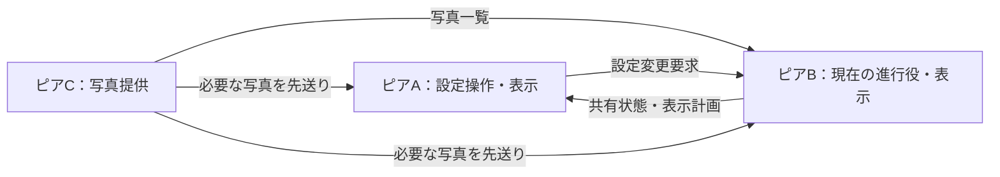

# ピア間ネットワーク機能の設計

作成・更新: 2026-10-18。通信・設定UI・写真転送・同期表示の実装を追加。WindowsとMacのビルド・自動検証、Mac上のSwift／.NET間の相互TLS・multicast検出を実施した。実際のMac↔Windows間のLAN・同期表示は未検証。[モジュール設計と検証状況](NETWORK-CORE.md)を参照。

2026-10-18の要件変更を反映する。[3画面同期計画](CROSS-PLATFORM-WALL-PLAN.md)の「Windows固定の進行役」「Windowsだけで全体を設定」「全PCに同じ写真が必要」という前提を置き換える。Mac単体の差分実装・隔離検証・合意済みのOS差分は従来の引き継ぎに従う。

## 1. 要件と設計案

**最優先要件は、視覚的・知覚的に自然な連続表示。** モード切り替え、ピア切断・再接続、進行役交代、60秒後のスタンドアロン移行のために出力ウィンドウを開き直さない。次の写真と背景の準備が整うまで直前の有効な表示を維持し、既存の表示面上で切り替える。通信・写真転送・時計の状態と、出力ウィンドウの寿命を分離する。画面構成の変更やOSの表示面破棄などによる再生成も、通常のモード切り替えから独立した処理とする。[表示の原則と受け入れ基準](CROSS-PLATFORM-WALL-PLAN.md#最優先の設計原則視覚知覚の自然さ)を共通基準とする。

ユーザーから指定された要件:

- サーバー／クライアントを担当するピアを動的に変更できる。
- 接続中のいずれかのピアにある写真を利用できる。事前の全台コピーを必須にしない。
- 全体の処理をまとめる進行役を置けるが、設定操作のためにその端末を開く必要はない。
- 全ピアの画面を既存の画面グループ管理へ合流させる。各画面はピアをまたぐ共通グループに属するか、単独表示を選ぶ。ピア単位で表示を分離しない。
- 各ピアで共通時刻を参照できる前提とし、既存の表示ロジックを活かして写真・表示計画を先読みする。各ピアが予定時刻から表示状態を決める。
- 写真ソースの設定を適用した時点で、バックグラウンドのキャッシュ作成・ピア間転送を開始する。Macの写真を選んだ場合はMacからWindows等の利用ピアへキャッシュ用データを転送し、通信中と永続保存時の双方で暗号化する。
- 切断時はOS通知を送り、バックグラウンドで再接続を試みる。切断中は直前に適用されたモードを1分間繰り返し、復旧しなければ再接続試行を続けながらスタンドアロン再生へ移る。再接続時もOS通知を送り、表示同期を再開する。
- 残ったピア同士は同期を続ける。切断で孤立したピアだけを1分の待機・スタンドアロンへ移し、進行役が落ちた場合は残ったピアから自動的に後任を選ぶ。
- 写真キャッシュは原寸・元の画質を維持する。同じ提供ピアの写真ソースを選択して適用し直した場合は旧キャッシュを削除・更新し、有効期限は14日とする。
- 顔データは写真の読み込み時にメタデータとして生成し、写真とともに暗号化して同期する。
- 「オンラインモード」を有効にすると待受・ピア検出を開始する。検出した相手を接続候補へ表示し、「接続」で参加する。接続を受ける側で確認ダイアログやコード入力を要求しない。

以下はこの要件を具体化する設計案。進行役の自動引継ぎ、残存ピアの同期継続、孤立側のフォールバック、原寸・14日期限の暗号化キャッシュ、顔メタデータ同期、受信側確認なしの接続を確定要件とする。自動選出・分断後の接続群の統合など、制御プロトコルの具体手順は詳細設計で定める。

## 2. 全ピアが持つ機能と、一時的な役割

Mac／Windowsとも同じ通信上の役割を実装する。初期の実機検証はMac 1台＋Windows 1台・3画面で行うが、端末IDや接続先を2台専用の構造にしない。

| 機能・役割 | 責務 | 担当 |
|---|---|---|
| 操作窓口 | 全体の設定表示・変更要求、再生操作、状態表示 | 許可された任意のピア |
| 進行役 | 共有設定の変更順序と、各グループ／単独画面の写真抽選・配置・動き・背景・再生時刻を管理 | ウォールごとに選ばれた1ピア。交代可能 |
| 写真提供元 | 公開した写真一覧と、要求された画像データを提供 | 選択された1台または複数のピア |
| 表示部 | 共通の計画と時刻に従い、担当画面を描画 | 表示に参加する各ピア |

同じピアが複数の役割を兼ねてよい。写真提供元を進行役に固定しない。表示する画面がないピアでも、対応する処理能力と権限があれば操作・写真提供・進行役を担当できる。

サーバー／クライアントは接続ごとの役割とする。進行役が全体の制御要求を受け、他のピアはそこへ接続する。一方、写真取得では写真提供元がサーバーになり、表示部がクライアントになる。各ピアは両方向の接続に対応し、進行役の交代時に制御先を張り替える。すべての写真を進行役経由で中継する必要はない。



これは役割の例で、3台を必須にする図ではない。2台ならAまたはBが写真提供元も兼ねる。

## 3. どのピアでも同じウォールを設定する

各アプリの設定画面で対象のウォールを開く。進行役の設定画面をリモート表示する方式ではなく、各OSのネイティブUIから共有状態を読み書きする。進行役の端末で設定ウィンドウが閉じていても、処理は常駐して継続する。

| 設定の範囲 | 例 | 扱い |
|---|---|---|
| ウォール共通 | 画面の所属・配置、モード・動き・見た目、写真ソースの選択、進行役の方針 | どの許可済みピアからでも変更を要求でき、全体へ配布 |
| 端末固有 | オンラインモード、ログイン起動、ローカルフォルダー権限、PhotoKit権限、キャッシュ予算、OS固有設定 | 所有ピアが保持・検証・実行。秘密情報を共有状態へコピーしない |

共有する画面IDは `(peerId, displayId)`、写真ソースIDは `(peerId, sourceId)` とする。画面名やグループの表示名を内部IDにしない。

### 画面はピアをまたいで既存のグループ管理へ合流する

ウォールは、参加ピア・全画面の一覧・共通グループ一覧を持つ管理範囲とする。ピアは画面を所有して実際に出力する端末であり、画面グループの境界ではない。「使用ディスプレイ」「画面グルーピング」を全ピアの画面へ拡張し、どのピアの設定画面でも同じ一覧と所属を編集する。端末名は画面の識別・接続状態の補助として表示する。

各画面は表示対象かどうかと、所属先を別々に持つ。所属先は共通グループIDまたは「単独表示」（既存UIの「独立して表示」）とする。1画面が複数のグループへ同時所属することはない。表示対象から外しても所属・配置を保持する。

| 画面 | 所有ピア | 所属の例 |
|---|---|---|
| Macの画面1 | Mac A | グループ1 |
| Windowsの画面1 | Windows B | グループ1 |
| Windowsの画面2 | Windows B | 単独表示 |
| 追加PCの画面1 | PC C | グループ1または別の共通グループを選択可能 |

この例ではMac AとWindows Bの画面1が1つのキャンバスを構成し、Windows Bの画面2は別の写真・時計で再生する。同じピアの画面を別グループへ振り分けても、異なるピアの画面を同じグループへ入れてもよい。単独表示の画面も共有一覧から管理し、接続ピアの写真を利用できる。

- **グループ単位の再生:** 同じグループは共通のモード・計画・時計・フェード・背景を持つ。グループ間と単独画面の再生は独立させる。進行役が1台でも、全グループを1つのキャンバスやタイムラインへまとめない。
- **既存の画面単位表示:** モードごとの「ディスプレイごとに表示」はグループ内の描画方法。所属やグループの時計を維持するため、「単独表示」とは別の設定とする。スパン時の顔境界回避と小画像の自動ミラーも既存の意味を維持する。
- **配置と出力:** 物理pxの配置と外接キャンバスはグループ単位で計算する。各ピアは、自分が所有する画面に対応する領域または画面別シーンだけを出力する。OSのデスクトップ座標をそのままネットワーク上の配置にしない。
- **参加・離脱:** ピア追加時は画面を共通一覧へ追加し、既存グループへの所属・配置を設定できる。自動でピア専用グループを作ったり、検出された全画面を表示対象にしたりしない。切断時は画面ID・所属・寸法・配置を保持して未接続と表示し、残った画面へ詰めない。復帰時は同じ所属へ戻す。
- **所属変更・削除:** 移動前後のグループを同じ設定バージョンで更新し、関係する表示部の準備後に共通時刻で切り替える。空グループも保存する。グループ削除時は未選択・未接続を含む全所属画面を単独表示へ戻し、表示対象・配置・画面固有設定を保持する。
- **既存設定の取り込み:** 既存のグループと所属を出発点にする。別ピアのローカル設定を取り込むときは安定した共有IDへ対応付け、同じ名前だけでグループを合併しない。既存の共通グループへの割当ては設定ドラフトで明示し、保存せず閉じた場合は適用しない。

表示計画・Ready・開始予約・背景には対象のグループIDを持たせる。単独画面は画面IDに対応した独立の再生単位とする。準備待ちは対象の再生単位に必要な表示部へ限定し、無関係なグループの再生を止めない。全体の開始・停止・一時停止・Nextは、これらの再生単位へ配布する。

### 共有設定の保存と操作

設定変更の流れ:

1. UIは確定済みの設定バージョンと共有状態を受け取り、ローカルのドラフトを編集する。
2. 保存時に変更内容・元の設定バージョン・要求IDを現在の進行役へ送る。
3. 進行役が権限・整合性・必要な端末の対応能力を検証し、共有状態の確定手順へ渡す。単に受信しただけでは保存成功としない。
4. 確定した設定バージョンと適用時刻を関係するピアへ配り、全UIへ結果を通知する。設定の保存完了と、表示準備・実際の適用完了は区別する。
5. 同じバージョンを複数UIから変更した場合、後続の古い要求は競合として返す。変更内容を保持したまま最新版を確認できるようにし、黙って上書きしない。

写真ソースの設定が保存・適用されたら、そのバージョンに対応するキャッシュジョブを開始する。ドラフトで写真ソースを選択しただけでは写真本体のピア間転送を始めない。保存結果と転送進捗は別に表示し、設定UIを閉じてもジョブを継続する。

交代・再接続中も未保存ドラフトを保持する。応答が失われた保存要求は、同じ要求IDで結果を照会・再送し、二重適用を防ぐ。再生／一時停止／Nextも同様に任意のUIから要求できる。

遠隔の写真ソースは、その所有ピアが登録・公開したフォルダーやアルバムから選ぶ。OSのファイル選択・アクセス許可が必要な操作は所有端末で行う。全体の設定画面を開く場所と、OSが要求する権限付与の場所は別に扱う。

## 4. 設定適用時に写真をバックグラウンドで暗号化キャッシュする

設定を適用した時点で、選択済みソースの写真を対象にバックグラウンドのキャッシュ作成・転送を開始する。次に表示する写真の抽選を待って取得を始める設計から変更する。Macのアルバムを選択した例では、Macが転送用画像を準備し、Windows等の利用ピアへ転送する。操作したピア・進行役・写真提供元は同じでなくてよい。

写真の候補集合は選択済みソースから作り、再生への採用は必要な表示部でキャッシュ・描画準備ができた画像を対象にする。同じ内容は写真IDでまとめ、複数ピアが持っていれば提供候補を複数記録する。接続しただけで全フォルダーを自動公開することはしない。

- 写真提供元は写真ID・向き補正後の寸法・形式・ソース内の版・取得可否を通知する。ローカルパスを他端末が直接解釈する必要はない。
- 転送する確定済み画像のバイト列のSHA-256を画像IDにする。通常ファイルは内容を変更せず、元の形式・画素数・画質を維持して転送する。PhotoKitの編集済み画像などは、原寸・最高品質の転送用画像を確定させてからIDを付ける。キャッシュのための縮小や非可逆な再圧縮を行わない。Photosからの具体的な取得形式は実機で確認し、原寸・画質を保てない場合はその画像を準備失敗とし、黙って低画質へ切り替えない。
- 提供元で更新中・エクスポート中・クラウドから未取得の写真は、取得可能になるまでReadyの対象にしない。利用者へ準備中の理由を表示する。
- 通信再開時は同じキャッシュ世代内の有効な検証済みデータを再利用し、不足分をジョブへ登録する。同じピアのソースを再選択・適用する明示的更新では旧世代を再利用しない。ローカル画像から永続の共有用キャッシュを作る場合も暗号化する。任意のファイルパスを要求できるAPIにはしない。
- 転送は暗号化・認証済み接続で行い、サイズ上限・同時取得数・ディスク予算を設ける。完了時に内容のハッシュと保存データの認証を検証してからキャッシュへ登録する。
- 受信画像は暗号化した再生用キャッシュとして扱う。受信側の写真フォルダーへ自動登録する仕様にはしない。対象は選択したソースとその更新分であり、未選択のライブラリー全体を複製しない。表示中・先読み中の画像を保護し、他は予算内で管理する。

### 適用から再生準備までの流れ

1. 写真ソースの設定を適用し、ソースの版と画像一覧から転送対象を確定する。転送先は、その写真を利用するグループ／単独画面の表示ピアと、解析・背景生成に画像が必要な進行役とする。
2. 写真提供元は原寸・元の画質の転送用画像を準備し、読み込み時に顔メタデータを生成する。MacのPhotoKitでは編集済み画像の取得・必要なクラウド取得もバックグラウンドで行い、準備中や取得失敗を通知する。提供元で永続化する画像と顔メタデータも暗号化する。
3. 適用時のキャッシュ世代を確認し、画像と対応する顔メタデータをバックグラウンドで送る。明示的な再適用では旧世代を削除・再作成し、通信再開・写真の追加編集では有効な世代内の不足・変更分を送る。ジョブは提供元と転送先が処理し、操作UIや進行役を画像中継の必須経路にしない。
4. 転送先は受信データを暗号化して保存し、検証済み画像の一覧と進捗を共有する。転送済み件数・容量・残件・中断理由を、任意ピアの設定画面から確認できるようにする。
5. 先に使う写真を優先して準備する。全件キャッシュの完了と、最初の計画を同期再生できる状態は分け、対象の全表示部で用意できた写真から計画を作る。全件完了を再生開始の必須条件にはしない案とする。

キャッシュ対象は選択ソースの全写真を基本とし、容量上限に達した場合は未キャッシュ件数と理由を表示して待機する。追い出した写真を同じジョブが直ちに再取得する循環を避ける。具体的なディスク予算は詳細設計で決める。ディスク上の写真キャッシュは原寸とし、描画時のメモリ／GPU用のデコードサイズとは区別する。縮小した背景・サムネイルは派生データとして原寸写真と別に管理する。

### 提供ピアごとの更新と14日の有効期限

同じ提供ピアの写真ソースを再選択して適用した場合は、そのピアの共有用写真・顔メタデータを新しいキャッシュ世代へ更新する。写真ソースの再適用を更新契機とし、表示モードだけの変更や自動再接続を全件更新の契機にしない。未保存のドラフトでも削除しない。

適用時に旧世代を無効化して新しい計画の候補から外し、各キャッシュ保持ピアで旧ファイルを削除して新世代を作り直す。表示中の画像はデコード済みメモリで必要な間だけ維持できるが、旧世代を新規再生や転送へ再利用しない。切断中のピアには世代更新を再接続時に渡し、古い世代の完了通知・転送・顔データを受理しない。別の提供ピアの有効なデータは削除しない。画像IDが同じでも世代ごとの参照を分け、物理削除の単位で他ピアのデータを失わないようにする。

有効期限は各キャッシュオブジェクトの生成・検証完了時から14日（336時間）とする案とし、`cachedAt`・`expiresAt`を記録する。閲覧・再生・自動再接続だけで期限を延長しない。同期時は提供元の版・キャッシュ世代・画像ID・顔メタデータ版を照合する。期限が近いデータはバックグラウンドで更新し、更新・検証できた新しいオブジェクトだけに新しい期限を付ける。

期限切れの画像と顔メタデータは新しい計画へ採用せず、参照を外して削除する。既にデコードした表示は切替可能になるまで維持できるが、期限切れファイルを再び復号・再生して期限を延ばさない。提供元が不在なら更新待ちとし、有効なキャッシュや適用済みのローカルソースを使う。利用可能な写真がなければ最後の描画可能な表示を保持する。キャッシュ期限と、孤立後1分でのスタンドアロン移行は独立した条件として扱う。

再接続・アプリ再起動では有効な同一世代のデータを再利用し、不足分を再開する。写真の追加・編集は差分ジョブへ反映する。設定変更で不要になった旧ジョブは中断し、旧バージョンの完了通知で新しいソース一覧を上書きしない。ソース解除時は今後の転送を停止し、他の有効な参照がないキャッシュを削除する。解除情報は切断中のピアへも再接続時に反映する。

### 顔データを写真メタデータとして同期する

写真提供元は、写真をキャッシュへ読み込むときに既存の顔検出器で解析し、顔矩形をメタデータとして生成する。写真と結び付いた別データとして保持し、元の写真ファイル自体を書き換えない。進行役・表示ピアへ同じ解析結果を配り、端末ごとに検出し直して配置が変わることを防ぐ。進行役交代時も同じメタデータを引き継ぐ。

メタデータには、提供ピア・ソース・キャッシュ世代・画像ID、向き補正後の画素数、顔矩形の配列、解析状態、検出器／モデルの版、メタデータ版を含める。顔矩形は向き補正後の画像を基準とした左上原点・0〜1の正規化座標とし、表示ロジックが必要に応じて画素座標へ変換する。未解析・顔なし・解析失敗を区別し、解析失敗で準備が永久に止まらないようにする。

写真だけ届いても、必要なメタデータの版・状態が揃うまで顔を使う表示計画を確定しない。顔なし／解析失敗では進行役が全ピア共通の顔なし動作を確定できる。解析結果を更新する場合は版を上げ、確定済み計画の途中で差し替えず次の計画へ反映する。メタデータも写真と同じ世代・期限・更新削除規則で暗号化保存・転送し、メタデータだけの更新で写真の期限を延長しない。顔の氏名や人物識別を同期する仕様にはしない。

### キャッシュの暗号化と鍵管理

暗号化要件は確定事項とし、以下は実装方式の案とする。共有・転送のためにアプリが永続化する写真本体、サムネイル、背景プレビュー、写真由来の索引・メタデータ、転送途中の保存データを対象にする。ユーザーが元から持つ写真は入力ソースとして読み取る。

| 対象 | 方針 |
|---|---|
| ピア間通信 | オンライン待受で受け入れた接続について、端末IDと交換した鍵情報を使うTLS接続で転送する。初回の受信側承認やコード入力を追加しない |
| ディスク上のキャッシュ | AES-256-GCM等の認証付き暗号を使用し、内容の暗号化と改ざん検出を行う |
| 一時・中断ファイル | 書込み段階から暗号化する。平文画像を一時ファイルへ出してから暗号化する手順にしない |
| 復号鍵 | 各ピアで生成し、Windowsはユーザー単位のDPAPI、MacはKeychainで保護する。設定JSON・ログ・キャッシュ本体へ平文鍵を保存しない |
| 表示・デコード | 必要な画像をメモリ上で復号し、既存のデコード／描画へ渡す。アプリが平文の中間画像やデバッグ用画像をディスクへ出力しない |

保存鍵は端末ごとに独立させ、進行役の交代や写真転送で端末の保存鍵を配布しない。提供元が暗号化キャッシュを持つ場合はメモリで取り出して認証済み暗号化通信へ渡し、転送先は自分の保存鍵で暗号化する。Macの暗号化ファイルをそのままWindowsの鍵で読める前提にはしない。

認証付き暗号は既存の暗号APIを使い、同じ鍵でnonceを再利用しない。保存形式の版・不透明なオブジェクトID・チャンク順序等を認証へ結び付け、必要な復号・検証が完了した画像だけを利用可能にする。再開可能なチャンク形式・鍵の世代管理・索引の暗号化形式は詳細設計で定める。外部ファイル名や平文ログへ元のファイル名・アルバム名・鍵を出さない。改ざん・鍵の喪失時はそのキャッシュを利用せず再取得可能な状態へ戻し、平文保存へ切り替えない。

方式の確認先: [.NET AesGcm](https://learn.microsoft.com/en-us/dotnet/api/system.security.cryptography.aesgcm?view=net-10.0)、[Windows ProtectedData／DPAPI](https://learn.microsoft.com/en-us/dotnet/api/system.security.cryptography.protecteddata?view=windowsdesktop-10.0)、[Apple Keychain services](https://developer.apple.com/documentation/security/keychain-services)。暗号化する保存形式・鍵の保護・転送の相互運用は実装時にそれぞれ検証する。

### 先読みした表示計画を共通時刻で評価する

進行役はグループ／単独画面ごとに写真と顔メタデータの準備状況から候補を選び、表示計画・背景を先に共有する。表示部は暗号化キャッシュから画像と対応するメタデータをメモリへ復号し、デコード・描画準備後にReadyを返す。余裕のある将来時刻を含む確定した予定を事前に共有し、各表示部が共通時計からタイミングを判断する。Readyや予定の受信時刻を再生の起点にしない。顔の配置計算と共通背景生成に必要なデータを進行役にもキャッシュし、提供元が生成した顔データを使う。写真転送は制御・時計合わせを詰まらせないよう別キュー／接続で扱う。

全ピアが同じ時刻軸を参照できることを、同期再生層の入力条件とする。時計を合わせる仕組みと、写真を表示する仕組みを分ける。OS側の時刻同期を使うか、アプリ内で共通時刻へ対応付けるかは別途具体化する。OSの時刻設定を自動変更する仕様にはしない。時計差の測定は前提が成立しているかの確認に使い、毎フレームのネットワーク通信で進行を指示しない。

表示計画には、対象・版・写真ID・確定した配置と動きに加え、適用時刻、シーンの開始位置と時間、Galleryの交換・スクロール流入・フェード・背景の予定を含める。次の構成とその途中の交換を前もって準備し、到着順や端末ごとの乱数でタイミングを変えない。先読み量は画像・GPU・ディスクの予算内で決め、先読み済みの範囲も状態として共有する。

一時停止のない例では、共通時刻100秒に始まる10秒のシーンを全ピアが事前に保持する。共通時刻102秒では全ピアが経過2秒、時間進捗20%として既存の動き・フェード関数を評価する。102.1秒に描画が遅れたピアは経過2.1秒を表示する。予定時刻直前や表示中の開始通知を必要としない。

グループごとの一時停止・再開には、共通時刻とグループ再生位置の対応を持つ。

```text
groupPosition = anchorPosition + rate * (sharedNow - anchorTime)
sceneElapsed  = groupPosition - scene.startPosition
progress      = clamp(sceneElapsed / scene.duration, 0, 1)
```

`anchorTime`は共通時刻、`anchorPosition`と`scene.startPosition`はグループの再生時間軸、`rate`は再生中1・一時停止中0とする。予約した適用時刻に対応を切り替え、既存の定速移動・イージング・停止後の保持・フェードを`sceneElapsed`から評価する。シーン開始前は準備だけを行い、現在の表示を維持する。完了したシーンは予定に従って次へ移る。同じ仕組みを単独画面にも適用し、再生時間軸はそれぞれ独立させる。

既存実装の利用範囲と変更点:

- **維持する部分:** 写真の適性判定、顔による配置、パン・Zoom・Galleryの幾何、画面への切出し、動きとフェードの曲線、画像準備・キャッシュを活かす。同期時の抽選・配置結果は進行役が確定し、表示部で再抽選しない。
- **Windows:** `AnimationScheduler`の相対待機と`TransitionController`のローカルなStoryboard開始に、共通の再生位置を渡せる入口を設ける。準備完了後に`ShowAsync`を呼んだ瞬間が0秒になる経路や、前の処理完了から相対待機を積み上げる交換処理は、そのまま同期の基準にしない。既存の描画・アニメーションを使いつつ、初回・復帰時の経過位置設定と継続中の時計差の追従を検証する。
- **Mac:** `WallPlaybackClock`と`presentation(atActiveTime:)`等の経過時間による評価を活かし、共通時刻からグループ再生位置を渡す。画像待ちの解除時刻に`sceneStartedAt`を付け直す動作や、写真待ちでローカルなスクロール時間だけを止める動作は同期モードの予定へ合わせる。
- **単体再生:** 同じ表示ロジックへローカル時計とローカルの先読み計画を渡す。同期のために描画方式全体を作り直す前提にはしない。

再生・一時停止・再開・Next・設定適用も、進行役が将来の適用時刻を付けて事前共有する。Readyは準備状況であり、即時再生の合図ではない。受信処理・タイマーの発火時刻にばらつきがあっても、描画時の共通時刻で位置を求める。前景アプリによるローカル描画休止中もグループの時間は進め、露出時に現在位置へ戻す。

準備不足が予定の確定前に分かった場合は、そのグループの予定を調整する。確定後にデータが間に合わなかったピアは最後の表示を保持して未同期とし、揃った時点の再生位置または次の予定境界から復帰する。各ピアが独自に開始を遅らせたり、過去の交換イベントを順番に再生して追いかけたりしない。予定変更も事前共有するが、通信断による通知未達まで同時切替を保証するものではない。

提供元が切れたときは転送ジョブを中断状態にし、有効な取得・検証済み暗号化キャッシュと他の提供元から取得可能な画像を利用する。同期できる残存ピアはキャッシュ済み写真と顔データで同期を続ける。取得できない写真を新しい計画へ入れない。表示直前に失敗した場合は進行役が計画を差し替える。同期再生中は表示部が独断で別の写真を抽選しない。孤立側の繰返し・スタンドアロン再生でも、最後に適用済みのソースに属する有効なキャッシュを利用する。共有解除済み・期限切れ・旧世代の画像を再び候補へ戻さない。

## 5. 進行役の選出と交代

OSや写真の所在ではなく、プロトコル・計画形式・必要な描画モードへの対応能力を確認して候補を選ぶ。初回は自動選出し、正常に動いている進行役は新しいピアの参加だけで交代させない。候補の優先順位にユーザー設定を必須とせず、安定したピアID等による決定的な順位を使う案とする。任意の設定画面からの明示的な交代も可能にする。

進行役の停止・通信断を検出した場合は、相互に通信可能な残存ピアから後任を自動選出する。設定画面の操作や旧進行役の復帰を待たない。通常時から共有設定・計画・時刻対応・顔メタデータ・要求結果を候補ピアへ複製しておき、選出中も確定済み・先読み済み計画で表示を続ける。新しい進行役はその時間軸と計画を引き継いで、次の計画を作る。選出手順・タイムアウト・同時立候補の解決は詳細設計し、順位だけで自動引継ぎが成立するとは扱わない。

通常の交代は以下の順で行う。

1. 交代先へ確定済みの設定・操作結果・計画・レイアウト・背景・抽選履歴を引き継ぐ。ローカルファイルへの参照やOSの権限は引き継がない。
2. 交代先が必要な画像と状態を用意できたら、新規操作の受付を短時間保留し、引き継ぎ中の要求の結果を確定する。
3. 交代の合意手順で新しい進行役の世代と切替点を確定し、全ピアが接続先を更新する。進行役IDを書き換えるだけの実装にはしない。
4. 共通時刻軸と各グループの再生位置・将来の予定を引き継ぐ。交代先の起動時刻や受信時刻を0秒にせず、単調時計の生の値を別PCでそのまま使わない。
5. 共通時刻で続行可能なら現在計画を継続する。状態が足りない場合は確定済み表示を保持し、準備した計画へ予約時刻で切り替える。

制御にはウォールID・接続群のセッションID・進行役の世代・設定バージョン・計画IDを持たせ、再生に関する命令には対象のグループIDまたは単独画面IDも付ける。交代時は全再生単位の状態を引き継ぎ、所属を変えない。新しい世代を受理したピアは旧世代からの命令を拒否する。ただし、別の接続群が独立して採番した世代を単純比較して統合しない。確定済み状態と要求IDの処理結果は交代先でも復元可能にする。

### 切断時の通知・1分の繰返し・スタンドアロン移行

ピアごとの接続状態と、グループ／単独画面ごとの再生状態を別に管理する。残ったピア同士が通信できる場合は、同じグループでも同期を継続する。切断でその接続群から孤立した側だけに以下の1分待機・スタンドアロンの遷移を適用する。残存側は切れたピアを待って全体を停止したり、一緒にスタンドアロンへ移ったりしない。切断画面の所属・寸法・座標を保持してキャンバスを詰めず、次の計画は接続中の表示部の準備で進める。ハートビート等による切断判定の閾値は詳細設計で決める。1分は孤立を確定した時点からの60秒とし、端末の経過時間で測る。

3台のA・B・CからCが切れた例では、A・Bが同期を継続し、Cが1分待機からスタンドアロンへ移る。Cが進行役だった場合はA・Bから自動選出する。2台から1台が停止した場合は、残った1台も同期相手を失うため、後任の制御役の決定とは別に1分待機からスタンドアロンへ移る。2台以上ずつの接続群へ分断した場合は各群で暫定セッションを分けて同期を継続し、再接続時に統合する。

| 状態・契機 | 再生 | 接続・通知 |
|---|---|---|
| 同期再生中 | 共通時刻・先読み済み計画で再生 | 接続を監視 |
| 他ピアが切断した残存側 | 同期を継続。進行役が失われたら自動選出して引継ぐ | 切断をOS通知し、切れたピアとの再接続を試行 |
| 切断確定〜60秒未満 | 直前に適用されたモードを取得済みデータで繰返し再生 | 切断をOS通知し、直ちにバックグラウンド再接続を開始 |
| 60秒経過、同期未復旧 | スタンドアロン再生へ自動移行 | バックグラウンド再接続を継続 |
| 認証済み接続が復旧 | 現在の繰返し／スタンドアロン再生を継続して同期を準備 | 再接続をOS通知し、共有状態・時計・計画・キャッシュ差分を取得 |
| 同期の予約時刻に到達 | 同期計画の現在位置へ切替え | 同期再生中へ戻る |

**最初の1分:** 最後に適用した表示設定と、その再生単位で有効だった表示モードを保持する。複数モードから抽選する設定でも、この間は切断時のモードに固定して繰り返す案とする。現在の構成を完了したら、保持した計画や検証済みキャッシュで同じモードを再生する。モードの1周を待ってから計時せず、切断確定から60秒で次の状態を判断する。同期中の配置・画面領域は保持し、切断画面の領域を詰めない。繰返し開始後はローカルな再生であり、同期済みと表示しない。

**1分後:** 復旧していなければ、既存の単体再生エンジンを使ったスタンドアロン実行へ移る。最後に適用した表示設定・選択ソースと、検証済みの暗号化キャッシュ／利用可能なローカル写真を使い、自端末の選択済み画面だけで再生を継続する。直前モード固定は解除し、適用済みのモード選択設定に戻る案とする。同じ共通グループに属していた自端末内の画面はローカルな一時グループとして扱い、ローカルの描画範囲で構成し直せるようにする。共有グループID・所属・配置・表示対象を上書きせず、遠隔画面を未選択扱いにして保存しない。

繰返しに必要な写真・計画を表示中もキャッシュへ保護する。必要なデータが不足して同じモードを作れない場合は、最後の描画可能な表示を保持して理由を状態に出す。未取得の写真を利用できる前提にはしない。ユーザーの停止・一時停止は、この自動遷移や再接続で勝手に解除しない。停止中でも有効なネットワーク参加に対する接続監視・再試行は継続し、アプリ終了や参加解除で終了する。

### バックグラウンド再接続とOS通知

再接続は表示ループ・設定UIとは別の処理で行う。登録済みの信頼するピアへ再試行し、間隔は上限付きのバックオフとばらつきを持たせる案とする。ネットワーク復帰・スリープ復帰時にも再試行し、スタンドアロン移行後も諦めず継続する。再試行間隔の具体値は詳細設計で決める。無応答の接続処理を重複起動しない。

OS通知は各端末のネイティブ通知へ送る。切断・認証済み再接続という状態変化ごとに送り、再試行のたびには通知しない。短時間の揺れは同じ通知を更新する等で重複を抑える。再接続通知は「接続が戻り、表示同期を準備している」ことを伝え、実際の同期完了前に「同期済み」と表示しない。通知の許可がない・OSが表示を抑制している場合も、再接続や再生を止めず、トレイ／メニューバーと設定画面へ状態を表示する。通知に写真名・アルバム名・秘密情報を含めない。

### 再接続後の同期復帰と共有状態

再接続時はピアを再認証し、現在の進行役・世代・設定バージョン・グループ所属／配置・共通時刻・現在と次の計画・背景を再取得する。キャッシュは不足・更新分をバックグラウンドで補い、対象の表示に必要なデータだけ先に準備する。準備後に将来の共通適用時刻を共有し、その時刻の計画位置へ切り替える。受信した瞬間のローカル再生開始や、離脱前の計画の0秒からの再開にはしない。

同期準備中に60秒を過ぎた場合もスタンドアロンへ移り、準備できた予約時刻で同期へ戻す。接続だけが一瞬復旧しても最初の切断時刻をリセットせず、同期復帰を完了してから障害状態を解除する。準備中の再切断は同じ障害として扱う。スリープ復帰時は経過した実時間を確認し、60秒以上の切断を新たな1分待機へ戻さない。

スタンドアロン再生は孤立したピアの一時セッションとし、残存側の共有設定を上書きしない。孤立中の全体設定は参照とドラフト編集に留め、ローカル操作や一時設定を復帰時に全体へ自動送信しない。通常の復帰では継続中の接続群の進行役・確定済み設定へ合流し、未保存ドラフトを適用する場合は最新版との競合を確認する。切断中に関係のない写真を自動選択したり、共有ソースの登録・解除を独自確定したりしない。

複数ピアを持つ接続群同士が再接続した場合は、採用する継続セッションと進行役を一意に決定して統合する。参加数を優先し、同数なら安定したIDで決める等の決定的な規則を詳細設計する。設定や再生操作を自動で混ぜず、非採用側の設定変更はドラフトとして確認可能にし、採用セッションの共通時刻・計画へ再同期する。復帰した旧進行役が役割を自動的に奪い返す動作にしない。

共有制御は接続群ごとの可用性を優先し、分断中もウォール全体で常に唯一の進行役が存在するという保証は置かない。固定メンバーの多数決が失われたら必ず全群停止する方式を、そのまま今回の要件へ適用しない。[Raft論文](https://raft.github.io/raft.pdf)は選出・状態複製の参考とし、接続群の形成・暫定権限・統合を含む具体プロトコルは別途定める。自動選出は必須とし、未確定なのはその実現手順とする。

## 6. 通信と実装の境界

### オンラインモードと接続操作

「一般」等の設定画面に端末単位の「オンラインモード」チェックを設ける。有効にした時点で待受・LAN上の存在通知・ピア検出を開始する。オンライン切替は通信状態へ即時反映する端末操作とし、写真・グループ等の共有設定ドラフトとは分ける。無効時は待受・存在通知・自動再接続を停止し、意図的な離脱を通信障害として再接続しない。表示は自端末のスタンドアロンへ切り替え、共有グループ所属は保持する。

1. オンラインモードを有効にしたピアがLAN上で見つかると、端末名・OS・接続状態を持つ「接続候補」へ表示する。検出だけでは接続・写真転送を開始しない。
2. 利用者が候補の「接続」を押すと、相手が待受中で対応バージョンなら接続を受け入れる。受信側に確認ダイアログ・承認ボタン・ペアリングコードを要求しない。
3. 初回接続で端末IDと鍵情報を自動登録し、暗号化した通信を確立する。保存した相手のIDと鍵情報を次回の再接続で照合する。初回接続の成立を人による相手確認済みと表現しない。
4. 接続後は同じウォールの画面・グループ・ソースを操作可能にする。既存ウォールへ参加する側はその共有状態を取得し、元のローカル設定を無条件に全体へ上書きしない。画面の所属とソース選択は共有設定として適用する。

オンライン待受は接続を自動受理する設定とする。公開する写真は選択・適用したソースの範囲とし、OSのフォルダー／PhotoKit権限は従来どおり所有端末で取得する。オンラインモードを有効にしただけで全フォルダーを走査・公開する仕様にはしない。

初期実装のLAN発見は、両OSの同じUDP multicast広告（239.255.77.87:47391、photowall-v1）を採用した。端末名・接続先・プロトコル版等の最小情報だけを広告し、写真・顔データを載せない。mDNS／DNS-SDは当初の候補として保持するが、実装済みの発見方式とは区別する。自動検出と候補からの接続を初期の利用フローに含める。

制御用の暗号化WebSocketと画像・メタデータ取得用HTTPSを候補とする。進行役の再発見には登録済みピアへの照会とLAN検出を使う。ポート・証明書の保存／更新・OSの受信権限・Mac sandboxの通信権限・接続上限は詳細設計と実機検証の対象。

| 境界 | 扱うデータ |
|---|---|
| ピア管理 | オンライン待受・自動検出・接続候補、自動受入、安定した端末ID・登録鍵、接続先、対応能力、自動選出、接続監視・再接続ジョブ、OS通知 |
| 共有状態 | 全ピアの画面一覧、共通グループと所属・配置、設定スナップショット、設定変更要求と結果、進行役の世代 |
| 写真提供 | 適用済みソース・原寸写真一覧、キャッシュ世代・14日期限、顔メタデータ、転送ジョブ、暗号化キャッシュ、進捗と利用可能一覧 |
| 計画作成 | グループ／単独画面ごとの確定済み計画、グループ内共通座標、顔による配置、交換・背景の予定 |
| 再生 | 共通時計、グループ／単独画面の再生位置、先読み・Ready、時刻付き予定の評価、切断中の1分繰返し・スタンドアロン・同期復帰、所有画面への表示領域の切出し |

現在の各OSのローカル再生へ通信処理を直接混ぜず、共有状態・計画・時計・写真取得の入口を分ける。単体モードはローカル実装を使用する。同期モードでは各OSが独立した写真抽選・顔位置の再解釈を行わない。WindowsとMacの双方で進行役を実装するため、計画の作成・評価の共通仕様とfixtureを持つ。

## 7. 試作と検証

1. **接続・操作と役割:** オンラインチェックで待受・検出し、候補の接続ボタンから受信側確認なしで接続する。Mac／Windowsのどちらからも全体設定を読み書きし、進行役の通常交代と停止時の自動引継ぎを検証する。UIを閉じても処理を続ける。
2. **写真取得:** 写真ソースの設定適用でバックグラウンド転送が始まり、片方だけにある原寸写真と読み込み時生成の顔メタデータを他方で暗号化保存・検証・先読みして表示する。進行役と提供元を逆にしても成立させる。
3. **座標と時計:** 共通格子・移動バー・写真1枚を3画面へ表示し、進行役を入れ替えて境界と提示差を計測する。
4. **演出:** Gallery・交換・パン・Zoom・共通背景を同じ計画で再生する。
5. **異常系:** 同時編集、保存応答の欠落、交代中のNext、転送途中の切断、提供元の消失、再起動、旧世代メッセージ、両側同時起動、切断中の再生と再接続を検証する。

画面グループの受け入れでは、異なるピアの画面による1グループ、同じピア内の別グループ＋単独表示、モード別の画面単位表示と単独表示の区別、追加ピアの既存グループへの割当て、未接続画面の所属保持、所属移動・空グループ・グループ削除・ドラフト取消を検証する。別グループの準備失敗が正常なグループを待たせず、進行役交代で所属・独立した再生状態が保持されることも確認する。

時刻の受け入れでは、同じ計画・共通時刻を入力したC#／Swiftの位置・透明度を比較する。計画の受信時刻に差を付けても、期限前に準備できれば同じ表示になること、開始時刻付近の通信を止めても先読み範囲を再生できること、描画遅延・一時停止／再開・Next・遮蔽復帰・進行役交代で時間軸がずれないことを確認する。画像準備不足と予定の遅着、時計差・時計補正・スリープ復帰も別に検証し、ログ上の時間一致と実画面の提示差を区別する。

キャッシュの受け入れでは、ドラフト選択時は写真本体を転送せず適用後に開始すること、UIを閉じても継続すること、同一世代での転送再開・追加編集の差分転送・容量不足・旧ジョブ中断を確認する。同じ提供ピアのソース再適用で旧ファイルが削除・更新され、他ピアのキャッシュを失わないこと、14日直前／期限到達での利用・削除・再取得、再生だけで期限が延びないことも確認する。通常ファイルの復号後バイト一致、元の画素数・画質の保持、顔データの座標・版・状態・世代の一致と誤った画像との組合せ拒否を検証する。写真・顔データ・サムネイル・索引・途中ファイルの暗号化、鍵の保護・改ざん検出・鍵喪失、未接続相手や登録鍵が不一致の相手からの取得拒否も確認する。

切断復旧の受け入れでは、3台のうち1台を切断して残った2台が同期を続け、孤立した1台だけが59秒／60秒の境界で繰返しからスタンドアロンへ移ることを検証する。進行役を停止した場合の自動選出・時刻と計画の引継ぎ、復帰した旧進行役の非奪回、2台が1台になった場合、複数接続群への分断と統合も検証する。切断・再接続のOS通知、再試行ごとの通知抑制、再試行継続、キャッシュ不足、通知抑制、スリープ経過時間、同期準備中の再切断、接続だけ戻った場合の期限維持、共通時刻での同期復帰、所属・配置の非変更、pause／停止保持も確認する。

接続の受け入れでは、候補の動的な追加・消失、受信側で確認を求めない接続、オンラインOFFでの待受・広告・再試行停止、再接続時の登録ID／鍵照合、両側同時接続の重複排除、対応版の不一致、オンライン切替と共有設定ドラフトの独立を検証する。

接続群内の自動選出・共有状態複製・分断統合の具体手順、切断検知の閾値・再試行間隔、暗号化保存形式・鍵の世代管理、PhotoKitの原寸取得方式・ディスク上限、顔メタデータ形式、発見・初回鍵交換の実装方式は引き続き設計する。ログ・転送試験用画像・スクリーンショット等は `artifacts/<OS>/` またはOS標準一時領域へ出し、通常の個人写真・設定と隔離する。暗号化の検証に使う画像は合成fixtureとし、通常の共有写真を平文の検証生成物へ書き出さない。
