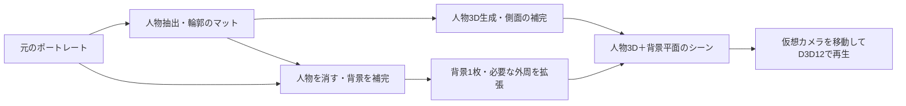

# 人物3D＋補完背景の設計

**作業終了:** ユーザー指定により、この実験は実用不合格としてここで区切る。追加の生成モデル研究・実装は進めない。[引き継ぎと最終評価](SPATIAL-PHOTO-HANDOVER-2026-10-26.md)を参照。以下の候補・検証案は設計時点の記録であり、継続作業の指示ではない。

2026-10-26。Issue #13の視差ワープ試作を実機で確認した結果を踏まえた方式。Windows用の[Alpha 2と検証記録](../windows/experiments/SpatialPhoto/PORTRAIT-ALPHA.md)を追加した。`release/windows/win-x64/portrait-alpha/PortraitAlpha.exe`で人物抽出→背景補完→人物3D生成→D3D12再生を試せる。以下の設計全体の完成や、人物品質の合格を意味しない。

Alpha 1はBiRefNet lite＋LaMa＋TripoSRのCPU生成と、人物メッシュ＋背景平面のネイティブ再生。上半身・全身各1枚で生成と正面／左右30°／左右60°のCLI描画を確認した。側面は生成されるが、顔・髪・手足の再現は粗く、広い背景補完もぼける。人物専用の生成器と正面テクスチャの改善が必要。生成ランタイムは別途`.tools/portrait-alpha/`へ取得し、このチェックアウト内のEXEから利用する。

Alpha 1の頂点色によるテクスチャはユーザー評価で不合格。Alpha 2では元写真の人物RGBAを元カメラから投影し、元視点の深度で隠面への誤投影を防ぐ描画を追加した。正面の細部は戻るが、生成面への切替・輪郭のずれ・側面への引き伸ばしは残る。人物生成器の採用確定や品質合格とは扱わない。投影は再生側だけの変更で、GLBへのテクスチャ焼き込みは未実装。

## ユーザーが求める構成

### 現行生成器の評価結果

ユーザーの実機評価で、Alpha 2も人物の立体形状の再現性が不足し、実用不可と判断された。現行のTripoSR経路は人物3D生成器として採用しない。元写真の投影は表面の細部を改善するが、顔・体形・姿勢・側面の形状の不一致を修正するものではない。CLIの成功件数は処理と描画の動作確認であり、人物再現の品質合格ではない。

この生成器の速度最適化や本体統合へは進めない。次の生成器は、背景合成・UIへ組み込む前に、同じ上半身・全身の写真から人物だけを生成し、正面・左右30°・左右60°で形状と外観を比較する。本人の顔、体形、姿勢、衣服、側面を保てるかを先に判定する。既存の人物抽出・背景補完・D3D12表示は工程別の検証基盤として残す。

### 要件

- ポートレートの人物と背景を分離し、人物には立体感を持たせる。
- 顔〜上半身と全身を同等の対象にする。どちらかだけの成功を完成とは扱わない。
- 大きな視点移動に耐えるよう、完全な全周復元を必須にせず、人物の側面を生成する。
- 背景は1枚でよい。人物に隠れていた部分を周囲の情報から補完する。
- DPWへの組み込みと配布を優先する。コードだけでなく重みと依存モデルの利用条件も確認する。
- Windowsのネイティブ再生を先行し、既存のDirect3D 12基盤を利用する。Mac／Metalは後続。

## 工程を分ける

### 人物抽出

元の解像度・向き・切り抜き位置を保持し、人物のRGBA画像とアルファマットを生成する。髪・指・眼鏡・衣服の透過部などを評価する。3D生成に渡す切り抜きと、背景から消す領域は同一と決め付けない。背景側は輪郭付近の色かぶり・髪の残像を消すため、補完用マスクを少し広げる。

複数人物、持ち物、背景に接触する家具、反射・影は別の判断が必要。初回検証では主となる人物1人を明示対象とし、持ち物を人物へ含めるかを記録する。複数人物対応を達成したとは扱わない。

### 人物の3D生成と側面

生成物は位置・形状・見た目を持つ3Dデータとする。単に切り抜きを板へ貼る方法や深度に沿って前面を起こしただけのメッシュは、側面生成の受け入れ条件を満たさない。

正面の本人らしさ、髪型、服、姿勢、シルエットをできるだけ維持し、写真にない側面の形状と外観を推定・生成する。方法は、人物専用の単画像3D生成、または整合する複数視点画像を生成して3Dへ再構成する経路を比較する。正面テクスチャは元写真を参照し、側面へ切り替わる境界に継ぎ目が生じないかを検証する。

人物3Dの形式は生成方式に合わせ、テクスチャ付きメッシュならGLB、3DGSなら必要な属性とカメラ情報を伴う形式とする。PLYという拡張子だけで点群・メッシュ・3DGSを同一視しない。

上半身では写真の下端で切れた体の扱い、全身では手足・衣服・床との接触を評価する。大きな移動範囲の数値はまだ未確定。まず正面／左右30°／左右60°の固定視点で比較し、許容できる範囲を測る。背面360°、上下への大きな移動や人物の関節アニメーションは初回の必須条件に含めない。

単画像にない側面は推定であり、本人の実際の形状を復元できたとは保証しない。本人らしさを維持できないモデルを、3D形状が出力できたという理由だけで採用しない。

### 背景の補完

人物の占有領域を消し、周囲の構造・色・模様から背景を生成する。元の背景の未編集領域はできるだけ保つ。髪の残像、輪郭の縁、人物の影の扱いを確認する。

カメラを大きく動かすと、人物の後ろだけでなく元写真の外側も必要になる。予定するカメラ経路から不足する背景の範囲を求め、外周の拡張生成またはトリミングを行う。単に背景を固定ピクセル数で広げれば全経路に十分だとは扱わない。

完成した背景は1枚のテクスチャとして保存し、人物の後ろに置く平面へ貼る。背景そのものの多層化・3D再構成は初回要件にしない。画面内の壁・床・家具の近景まで物理的に正しい見え方になるとは主張しない。

### シーンとカメラ

人物を前景の3Dオブジェクト、背景を後景の平面として配置する。元写真の視点では人物の大きさと位置が合うよう、カメラの画角・主点・切り抜き位置・人物スケールを揃える。

人物と背景の距離は、単画像だけで正確な実距離が分かるという前提を置かず、推定と演出用の調整を組み合わせる。背景平面のサイズは距離と画角から決める。同じ仮想カメラで双方を描き、奥行きに応じた自然な相対移動を得る。

人物の見た目の中心付近を注視しながらカメラを横方向に移動する。人物だけをその場で回して背景を固定する方法を、カメラ移動と同じ挙動として実装しない。側面の生成品質・元画像外の欠落に応じて、画像ごとに移動範囲を制限できるようにする。

## 保存単位とバックエンドの境界

1回の前処理で以下を保存し、通常の再生時にはAI推論をしない。

| 保存内容 | 目的 |
|---|---|
| 元画像の識別子・ハッシュ、向き、切り抜き情報 | 再生成と座標合わせ |
| 人物RGBA・アルファマット | 抽出結果の確認と再利用 |
| 人物3Dとテクスチャ／3DGS属性 | 独立した3D再生 |
| 人物を除去・補完・拡張した背景画像 | 背景平面への描画 |
| 元画像のカメラ・人物配置・背景距離・許容経路 | 再現できるシーン配置 |
| 各モデル／重み／前処理のバージョン・出力のハッシュ | 無効化と工程別の再実行 |

人物抽出・人物3D生成・背景補完は独立した処理とする。背景だけの再補完で人物を毎回作り直さず、カメラ設定の変更で推論し直さない。生成側のGPU・ランタイムと、D3D12の再生側を分けて検証する。

作業生成物は`artifacts/windows/portrait-alpha/`（旧視差版は`artifacts/windows/spatial-photo/`）、モデルは`.tools/portrait-alpha/`等のGit対象外へ置く。完成したテストアプリは`release/windows/win-x64/`配下へ置く。人物写真・生成した人物・キャッシュをソースに追加しない。既存の通常設定・写真・ネットワーク再生を変更しない。

## 候補と確認が必要な点

2026-10-26時点の一次資料を確認した候補。採用・配布・このPCでの実行確認を完了したという意味ではない。

| 工程 | 候補 | 確認状況・未解決点 |
|---|---|---|
| 人物抽出 | BiRefNet系 | [コードのMITライセンス](https://github.com/ZhengPeng7/BiRefNet/blob/main/LICENSE)と[公式重みのMIT表記](https://huggingface.co/ZhengPeng7/BiRefNet)を確認。採用する重み・変換版を固定し、髪のマット品質とDirectML等での実行を評価する |
| 背景補完 | LaMa系 | [上流コードはApache-2.0](https://github.com/advimman/lama/blob/main/LICENSE)。[公式README](https://github.com/advimman/lama)に配布元・利用例あり。重み・変換物・依存ライブラリの条件と、大面積の人物除去・外周補完の品質は採用前に確認する |
| 人物3D生成 | TRELLIS.2等の画像→3D生成 | [公式README](https://github.com/microsoft/TRELLIS.2)はコードとモデルをMITと明記。人物の同一性と側面は未評価。公式はLinux・NVIDIA 24GB以上・CUDAを前提としており、現在のWindows／RX 7900 XTXでそのまま動くとは扱わない。依存ライブラリは別条件 |
| 人物専用3D生成 | 人物再構成モデル群 | コードのライセンスだけでは採用しない。重み・体形モデル・顔モデル・生成用の補助モデルを含めて条件を確認し、上半身と全身の双方を比較する |
| Alpha 1の人物3D生成 | TripoSR | [公式README](https://github.com/VAST-AI-Research/TripoSR)はコード・重みともMITと明記。CPUで実行し、CUDAのmarching cubes拡張だけscikit-imageへ置き換えた。人物専用ではなく、正面の本人らしさは不足。方式を評価するための暫定バックエンド |
| 距離・カメラの補助推定 | MoGe-2等 | 点群・形状・カメラ推定の補助候補。可視面の幾何推定だけでは人物の側面生成を満たさない。今回の人物生成器の代替として完成扱いしない |

SHARPは[モデル規約](https://github.com/apple-aiml-research/ml-sharp/blob/main/LICENSE_MODEL)に研究用途限定と製品開発の除外があるため、DPWの配布用既定モデルとして採用していない。外部生成器との連携を持つことと、そのモデルの利用が許諾されることは分けて扱う。

## 最初の検証と受け入れ条件

最も不確実なのは人物の本人らしさと側面の生成品質。先にこの品質を比較し、背景や再生UIを完成させてから人物生成の不成立が分かる進め方を避ける。

1. 上半身・全身のそれぞれで、人物抽出→人物3D生成→正面と左右の固定視点の画像出力を比較する。正面・左右30°・左右60°を検証点とし、生成の時間・メモリと本人らしさの評価を記録する。未測定の速度や成功率を見積もりで実績にしない。
2. 人物マスクで背景を補完し、人物の後ろと外周を確認する。人物3Dと背景画像を別々にレビューできるようにする。
3. 同じカメラで人物3D＋背景平面をD3D12へ合成する。元視点での位置・サイズ、回り込み、前後の遮蔽、背景の範囲をCLIのオフスクリーン描画で検証する。
4. 専用のテストEXEでD&D→前処理→保存→再生の経路を統合する。GUI操作を伴う自動検証はユーザーの明示依頼時だけ実行する。

- [ ] 上半身と全身の両方で人物が背景から分離される。
- [ ] 人物には側面の形状と外観があり、単純な前面の引き伸ばしで代用しない。
- [ ] 正面の人物の顔・髪・衣服・姿勢を維持することを品質評価する。
- [ ] 人物の後ろの背景を補完し、元の人物が二重に残らない。
- [ ] 採用するカメラ経路で外周不足を扱い、背景の空白を露出させない。
- [ ] 背景1枚と人物3Dを独立した配置で描画し、元視点のフレーミングを再現する。
- [ ] 生成をキャッシュし、再生時にはAI推論を行わない。
- [ ] モデルと依存物の条件、Windows／AMDでの実行可否を確認する。未対応の場合は、その生成器を動作済みとして配布しない。

Alpha 1では生成と独立保存、キャッシュ、背景平面と人物メッシュの深度描画まで実装した。上半身・全身の実写真各1枚と合成図形でCLI検証を実施し、GUI自動操作は行っていない。上記チェック欄は方式全体の品質受け入れを表すため、人物の同一性・背景補完・フレーミングの品質を合格扱いしていない。段階別の独立再生成、人物専用モデル、本体統合も未完了。旧`SpatialPhotoTest.exe`は引き続き視差ワープ用で、新しい経路は別の`PortraitAlpha.exe`で確認する。
