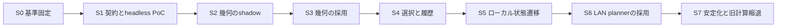

# Migration Roadmap — 段階移行と検証戦略

状態: 設計提案。2026-10-22 JST。**今回の作業は設計書作成で終了する。以下の実装は未着手。**
[現行分析](CURRENT-ARCHITECTURE.md)、[Render Plan/FFI仕様](PROPOSED-ARCHITECTURE.md)、[リスクと測定gate](RISK-ASSESSMENT.md)、[ADR](ADR-0001-SHARED-CORE.md)を併せて使う。

## 1. 移行原則と依存関係

1. feature branchの小さいPRで進め、mainは旧経路を既定に維持する。Windowsの一部純粋計算→Macの同じ計算→次の機能の順にし、片OSを丸ごと移行しない。
2. mode・速度・顔・Gallery・背景・設定・OS差分の受け入れ条件を保持する。Renderer全面置換・新しい抽選UX・新wire version・設定形式統一を混ぜない。
3. 各段階に`legacy / shadow / shared`の開発専用切替を持つ。通常設定UIには実装方式を露出しない。段階ごとに旧動作へ切り戻せるrelease candidateを保存する。
4. 新コードが旧コードを削除する前に両OSで同じ対象を検証する。旧ロジックを残す期間・対象は明確にし、二重実行を恒常運転の既定にしない。
5. GUI操作を伴う検証は、その時点でユーザーの明示依頼がある場合だけ実行する。CLI/単体合格を実機受け入れの代用にしない。



S1のGo/No-Go後にのみ製品へのFFI接続を始める。S2/S3ではselector・schedulerは既存、S4ではnative timersと描画clockは既存、S5でも毎frameはnative。S6は既存wireへの変換だけから始める。

## 2. 実装可能な移行単位

| 段階 | 変更範囲・入口 | 依存と検証 | 出口条件／rollback |
|---|---|---|---|
| S0 基準固定 | 合成catalog・設定・顔・topology・event fixtures、現在の計画を取得する開発用export。`tests/ParityVerifier`とSwift単体の現行FixedGallery/FaceMotionSafetyを追加で覆う | 旧fixtureは変更せず保存。実施時commit／配布元／環境を記録。ランダムな分岐はdecision tape化 | 現行のlocal/LAN差、失敗時挙動の基準が説明可能。製品の挙動変更なし。exportを無効化してrollback |
| S1 Core契約・headless PoC | `shared/dpw-core(-ffi/-contract)`、schema、C header、C#／Swiftの小CLI consumer。RNG・ID mapping・Q/U/µs・version・エラー契約 | 両targetでunit、C ABI size/ownership、canonical byte一致。1万／10万metadataの登録とplan call、起動／release ownershipの費用を測る | FFI・負荷gateを満たすこと。満たさなければ導入停止、C#/Swiftとfixture維持。appへのlinkはまだ不要 |
| S2 幾何をshadow | `MirrorPolicy`、mode適性、`FixedGalleryLayout.Arrange/Update`、`MotionEngine+FaceMotionSafety`。呼出点はWindows `PhotoRenderer.Build/ReplaceSlotAsync`と`WindowsScenePlanner`、Mac `WallMotionGeometry/WallPlaybackController`と`PNScenePlanner` | 同一の選択済み写真・明示reverse/anchor・顔・viewportを渡し、旧結果だけ描く。Windows→Macの順に採取 | 全mode・境界・安全性・旧値誤差gate合格。不一致分類完了。flag OFFだけで旧計算へ戻せる |
| S3 幾何をsharedへ | Windowsのmode別に小PR、同じ機能をMacへ。結果を既存MotionPlan／frameへ変換し、native element・clock・backgroundは継続 | 最初はmirror/適性→Pan/Zoom安全幾何→固定Gallery/reflow。各対象でS2比較が前提。packageのDLL/dylibロードも検証 | 対象について全旧callsiteを棚卸し、local/LANとも同じ幾何を使用。性能／画面連続性gate合格。旧幾何を残しflagで戻す |
| S4 selector・mode・履歴 | `PhotoSelector`、`ModeSelection`、`CompositionEngine`と`WallScenePlanner`の選択部分、`GalleryRotation`。画像prepareはnative | decision tapeで旧規則を比較し、Rust RNG自身は固定vectorで両OS一致。履歴更新点・seed stream・失敗／cancel・小library除外を検証 | 既存の名前順／重み／recent／mode skipを維持。native RNGとの列完全一致は要求しない。各group切替時のsnapshotを保持してrollback |
| S5 ローカルscheduler・Plan | `WallPlaybackSession.PlayAsync/UpdateGalleryGroupAsync/ScrollGalleryAsync`、`WallPlaybackController.update`、`WallGroupPlayback.update`の意思決定をeventへ。RはPlanから既存visualを作る | fake clockでpause/suspend/Next、generation、metadata待ち、gallery交換・scroll append。active time・scene fade開始の旧時刻と比較 | フレームRust呼出0、native clock・window保持。旧localに戻す際は最後の有効表示を保持し、次に準備できたsceneで切替。現在写真の同時刻への厳密復帰は保証しない |
| S6 LAN plannerをCoreへ | `WindowsScenePlanner.Prepare`と`PNScenePlanner.prepare`の選択・timeline・geometryを置換。`SharedScenePlan/PNScene`変換adapter、背景生成は既存 | `GalleryTimeline`の終端継続・rotation・次due・全Ready・leader変更・late prepare拒否。既存wire fixture／loopback／interopを保持 | wire v1意味が不変、受信側変更なしでも描画可能。進行役の次計画からlegacy plannerへ戻す。session/term/revisionは既存LANが所有 |
| S7 安定化・縮退 | 両OS既定をsharedへ段階切替。使わなくなった本番計算だけ削除、old geometry fixture用oracleは検証側へ残す | 24/72h、実機混在DPI／抜差し／復帰／LAN、CPU/GPU/memory/startup、package、ユーザー受け入れ | 全gate合格後に既定化。既知の未確認をhandoverへ。旧バイナリと設定backupでrollback。新機能／Linux Rendererは別計画 |

S3以降はappへnative dependencyが入るため、Rust非使用時のロード失敗でも旧経路が起動できる遅延ロードにする。Macで強制linkによりdylib不在時にapp起動前に失敗する構成はこのrollback要件を満たさない。初期段階は`dlopen/dlsym`を包む小さいC/Swift loader等でoptional loadを実現するか、完全な旧app bundleを復元する手順を明示する。CLI PoCでloader方式を決め、通常のC importだけでoptionalになるとは扱わない。

### 2.1 S0で先に解決する互換差分

| 差分 | 基準と扱い |
|---|---|
| パス同一性・名前順 | nativeのalias判定／sort結果を`asset_id/order_rank`へ正規化。locale/case差は入力差としてfixtureに固定。既存ユーザーの順序を変更しない |
| Windows/Swift RNG | native抽選列をRust seedの期待値に流用しない。選択ルール比較は共通decision tape、新Core再現は独自vector |
| preloadで消費する履歴 | `Remember`時点を記録。表示前取消でも消費済み履歴を戻さない。候補の部分失敗時の差はprofileへ明記 |
| small libraryとper-display不足 | 同時除外を緩める呼出点・全group失敗／一部surfaceの扱いを旧経路別に固定。安全な最終表示保持は維持し、無関係なバグ修正は別PR |
| local/LAN mode再抽選 | Gallery skipとcontinuation、chunk時間の差はpolicy。単一の固定durationへ揃えない |
| fadeとreflow | localのsine fade、LANのlinear fade、Windows localのサイズ補間とMac localの即時サイズ更新を別profileで保持 |
| 素のmotionと安全guard | 古いMotionEngine fixtureと現行FaceMotionSafetyの期待値を別suiteにする。旧Gallery loss最適化を復活させない |
| native geometryの微小丸め | Q/U/µs変換が適性・face-safe判定を変えないこと。閾値周辺は整数比較へ。差が視認できないという説明だけで合格にしない |

合意済みOS差はprofileに閉じる。単なる移植漏れと確定できない差は、対象機能をlegacyに残し、根拠と解決するPRを記録する。profileを恒久的に無制限に増やさない。共通profileへ統合できる対象から互換分岐を削除する。

## 3. Shadow Mode

### 計算の比較

ホストで一度だけ取得した不変input/stateを旧計算とCoreに渡す。旧結果を表示し、新結果は描画・画像準備・顔検出・通信・履歴の本番更新を行わない。比較で画像decodeやPNG背景を二重生成しない。

statefulな旧ロジックは検証用にsnapshot/clone可能な薄いseamを追加する。native RNGから出た「候補index、mode抽選値、reverse、anchor、interval」を型付きdecision tapeで記録し、旧cloneとCoreの検証専用random portへ再生する。本番C ABIに外部RNG callbackを追加しない。比較側は独立stateを保持し、本番selectorのRNGや履歴を消費しない。

純粋計算の比較は同じ写真と明示motion入力で即開始できる。mode・選択比較では単にnew Random(seed)とSwift generatorへ同じseedを入れる方法は使わない。乱数消費回数が違う場合は同じkindのdraw単位で比較し、必要なdrawが一致しない箇所を意味の差として報告する。

### 差分の扱い

差分recordにはcommit、OS/arch、version、profile、input/state digest、draw tape、assetの合成ID、比較fieldと旧新値を残す。カテゴリはID/順序、選択／state、幾何、時間、unsupported入力、期待するOS差。個人path・原写真・顔の実データを無断exportしない。通常はdigestと件数だけ、再現fixtureは合成データで作る。

幾何の旧新差は`1e-5px`以下、正規化anchor/cropは`1e-8`以下、時間は`2µs`以下を初期gate案とする。これは量子化誤差の許容量で、写真ID・mode・surface・slot数・顔安全の真偽・履歴・continuationの差は許容しない。旧値が非決定的な場合は同条件の出力集合と不変条件も比較し、黙って新しい期待値を正としない。

常時shadowは使わない。開発profileで対象eventを限定し、最大100件等のbounded ringと終了条件を設ける。計測はshadow OFFで行う。差分比較が計算負荷を増やすため、shadow稼働のCPUを製品回帰値に混ぜない。

## 4. Golden Testと決定性

将来のfixture例:

```text
tests/Fixtures/SharedCore/v1/
  rng-vectors.json
  selection-small-library.json
  fixed-gallery-landscape-portrait.json
  motion-faces-exif.json
  topology-mixed-dpi.json
  gallery-continuation-events.json
  failure-cancel-resume-events.json
  expected/*.plan.json
  expected/*.state.json
```

現在の`WindowsParity.json/WindowsDelta.json`、`MirrorPolicy.v1.json`、`AmbientColors.v1.json`、`NetworkWire.v1.json`は変更せず参照する。現行FixedGallery・FaceMotionSafety・新しい抽選／state sequenceを追加suiteで補う。古い期待値を一括再生成して「一致」としない。

Core出力はcanonicalなinteger JSON（固定field順・配列順、余分な空白なし）にし、Windows x64/macOS arm64でPlanとstateのbytes/digestが完全一致することを確認する。canonical encoderはCore側だけに置き、C#/Swiftで浮動小数やJSON辞書を再serializeした結果を比較しない。FFI wrapperの型付きdecode→既存型への変換は別の意味比較を行う。

fixtureの期待値は手計算できる小例、現行oracle、独立した不変条件の3種類で支える。seedとカタログだけでなく、順序、顔の既知状態、設定、topology、初期state、イベント時刻・sequenceを保存する。新Goldenの更新はalgorithm/layout version変更と差の理由をreviewする。

## 5. 検証マトリクス

| 分野 | ケース／方法 | 合格条件・実行環境 |
|---|---|---|
| RNG決定性 | seed 0/1/MAX、stream別vector、bounded n=1/2/3/非2冪、rejectionとwrapping、100万draw | x64/arm64のbyte完全一致。OSなしRust unit |
| 選択・重複 | 0/1/2枚、recent=0/30/10000、候補集合の一部更新、全除外、version変更、同名・case・Unicode・順序入替 | 同時除外と一巡／history緩和がprofileの期待値通り。ID・mode・stateはexact |
| 分布 | 固定seed集合でmode eligible一定、80/20系統・系統内均等・mode不足を別条件に。photoはrecent/cycleを分ける | 10万draw以上の事前固定sample。期待countに対する偏差を保守的6σ以内で検証。Gallery skip前のdrawと表示頻度を混同しない。flakyな毎回新seedを使わない |
| Gallery | 横長／縦長／正方形壁、1..20、gap=0/極大、超横長写真、入らない候補、追加／置換pin／退場、再配置取消 | 固定短辺、順序、間隔、境界、incoming採用、最終位置を保持。現在layout用Golden |
| 顔・crop | なし／unknown／失敗／複数／同面積、顔中心0.5、margin 24px/3%、全EXIF8方向、巨大顔、guard不能 | oriented座標が一致、再反転なし、unsafeなら候補skip、scale/clip/anchor/停止位置と3秒保持一致 |
| 5モードGolden | Gallery、gallery_scroll、vertical/horizontal pan、zoom。local/LAN、span/per-display/mirror | Plan・state exact、旧oracle誤差gate、curve・fade・duration・可視期間の意味比較 |
| 数値境界 | NaN/Inf入力をreject、0寸法、32768上限、巨大負origin、half mirrorの直前／等号／直後、overflow、Q丸めtie | crashなし、正しいstatus、state部分更新なし、境界branchの両arch一致 |
| 複数画面 | 負座標、上下ずれ、隙間、重なり、先頭画面が非原点、縦配置、2+1独立、空group、切断／復帰、混在DPI | fake screen providerでregion不変、切断領域を詰めない、group相互に履歴・clock干渉なし。DIP/point変換も別unit |
| 状態遷移 | fake monotonic時計でpause reason重複、sleep、Next、source変更、遅い顔、失敗、old result完了、重複sequence | 旧有効表示保持、User pause不変、stale結果拒否、next deadline有限、stop後資源参照解放 |
| Gallery継続 | 2時間以上をvirtual clockで進め、交換直前直後のchunk、rotation、scroll残り位置、120秒境界 | current写真と端点・次dueを保持、継続時scene fadeなし、segment上限とstate上限維持 |
| FFI | C/C#/Swift consumerでcreate/apply/snapshot/release反復、null+0、長さ上限、不正UTF8/JSON、未知version、無効handle、busy、panic注入 | allocator跨ぎなし、全statusとownership一致、poison後再使用禁止。ASan等の利用可能なnative sanitizerとRust側のMiriを適用範囲に限定 |
| LAN互換 | 既存wire vector、C#/Swift JSON変換、Ready遅延、leader交代、6秒断・60秒fallback、予約Commit、再接続、停止／pause | protocol値・具体的plan意味・背景色補正1回が不変。loopbackと実機通信を区別 |
| メモリ | 10万metadataを共有、複数group、次計画1件、outgoing終了、catalog差替え、100万apply/release | Core handle/bytes・metadata保持が定常で上限内。Rのpin・decode bytes・GPU面・通信PNG保持も別に測る |
| 性能・アイドル | [回帰測定gate](RISK-ASSESSMENT.md#2-性能メモリの測定gate案)のAB/BA、shadow OFF、同じ合成写真とtopology | 明示した回帰上限内。Core timer/threadなし、frame FFI0。既存native背景・display pacing維持 |
| 長時間と復帰 | virtual stressを先行し、専用profileで24h→72hの実運転、sleep復帰・画面増減・通信再断を含める | crash/hangなし、plan/handle/texture数がbounded、継続的なmemory増加の原因未解明を残して既定化しない |

property testはselection不変条件、crop範囲、overflow、event順とstate atomicity等の独立性がある条件に使う。実装をなぞるだけのfixture大量生成はしない。GPU／色／frame pacingはCore unitでは保証できないので、既存の[Windows測定](../../../windows/docs/RENDERING-PERFORMANCE.md)と[Mac測定](../../../macos/docs/SYNC-FRAME-PACING-MEASUREMENTS-2026-10-20.md)の条件を参照してnative側で検証する。

## 6. ビルド・CI・作業ディレクトリ

既存のWindows `Build.ps1 -Test`はpublish・配布物更新を伴う。設計調査や小さいCore検証で無条件に実行しない。検証だけならproject buildとCLI DLL実行を分ける。Rust導入時もrelease生成は明示gateにする。

将来のheadless検証手順案（Rust crate追加後のみ有効）:

```powershell
$env:CARGO_TARGET_DIR = Join-Path $PWD 'artifacts/windows/rust-target'
cargo test --manifest-path shared/dpw-core/Cargo.toml --locked
# FFI consumer・native unitは専用profileへ。publishは別工程。
```

```sh
CARGO_TARGET_DIR="$PWD/artifacts/macos/rust-target" \
  cargo test --manifest-path shared/dpw-core/Cargo.toml --locked
bash macos/scripts/verify.sh --unit-only
```

上記Rustコマンドは今回実行したコマンドではない。Macのverifyは単体・C#fixture・network core・Release compileを含む。GUIは既定で無効。将来CIのnative artifactをstageする場所は`artifacts/<OS>/shared-core/`、最終配布は`release/windows/win-x64/`／`release/macos/arm64/`。通常設定・個人写真・login・秘密鍵を使わず、既存regression app IDと専用data-dirを維持する。

## 7. rollback手順

### 機能単位

計算のshadow/geometry移行中は旧関数を保持し、flagをlegacyへ戻して次の計算から使用する。新Planが未確定なら破棄、表示中なら有効なnative visualを保持する。FFIエラーでrendererをClearしてからlegacyを準備してはならない。

S4以降は旧selectorも低頻度の選択eventに対してのみshadow stateを維持するか、明示snapshot importerを持つ。どちらを使うかはS4開始時に1案へ固定する。推奨は移行期間中の旧selector shadowで、Core出力を描画している間も同じdecision tape／eventを旧selectorへ適用し、decoderや描画は二重化しない。state互換に失敗したら次scene境界で旧sessionを再作成する。次に選ばれる乱数列の完全保存は保証外だが、モード／名前順／pause等のユーザー設定は維持する。

### 配布単位

候補作成前のEXE／app bundle全体とBUILD-INFO・hashを`artifacts/<OS>/shared-core/previous-release/<candidate>/`へ保存する。単独DLLだけを旧appへ差し替えない。旧app全体を元のrelease pathへ戻し、設定のschemaを変えていないことを確認して起動する。起動・停止を伴う実機操作は当該段階の実行依頼に従う。mainへのrevertも機能単位PRで可能にする。

通常設定形式を変更しないため破壊的なdown migrationは不要。開発用snapshotとflagは通常の保存値へ混入させない。旧計算を削除するS7以降は旧release bundleがrollback手段になる。

## 8. 実装開始前の完了条件

- S0でnativeの現行FixedGallery、安全motion、small library／per-display部分失敗の基準が揃う。
- S1でoptional loader、canonical schema、整数精度、FFI memory所有権、catalog上限と新旧誤差が確定する。
- Windows x64/macOS arm64で同一Planとstateを出せる。実測のstartup／memory／plan costがgate内。
- 専用profile・成果物パス・package検証・旧app復元がreview可能な状態になる。

今回はこれらの実装や実機検証を始めない。今回確認した既存CLIの結果は[Current Architecture Analysis](CURRENT-ARCHITECTURE.md#5-今回の検証と未確認)に限定する。
