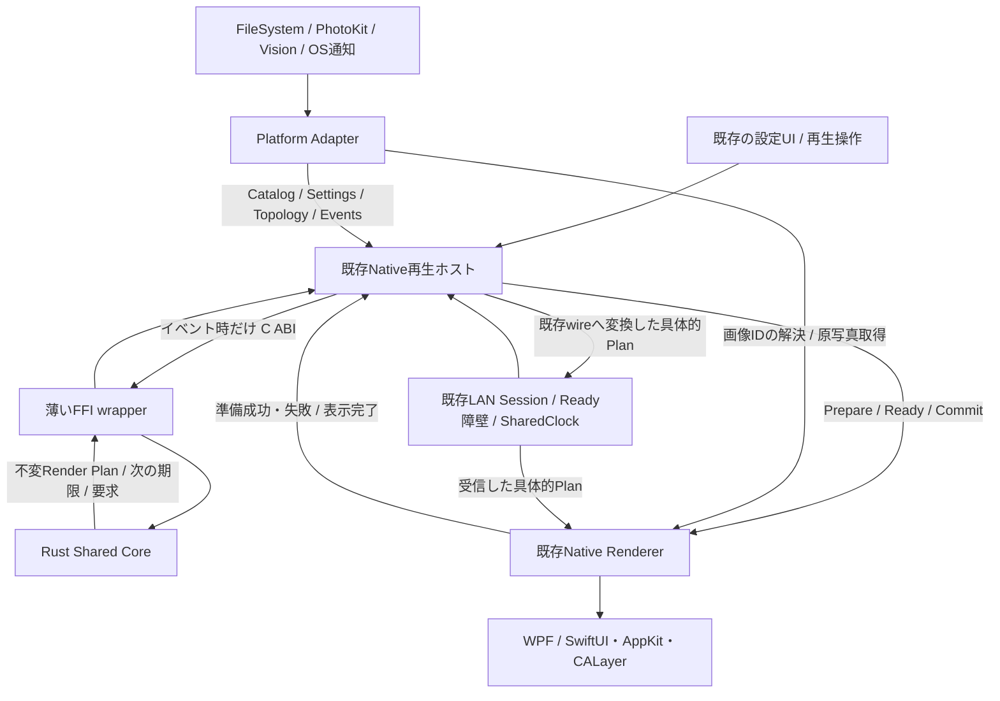
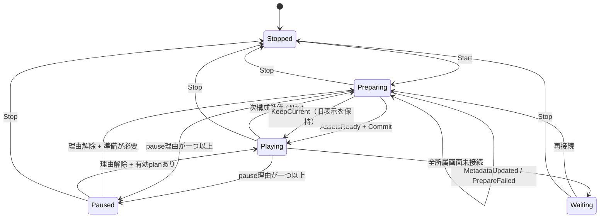

# Proposed Architecture — Shared Core / Native Renderer

状態: **設計提案・未実装**。2026-10-22 JST。[調査基準とコード根拠](CURRENT-ARCHITECTURE.md)に対応する。
推奨は、純粋なRust計算ライブラリーをC ABIの`cdylib`として同一プロセスから呼び、既存の描画・画像資源・OSサービス・通信モジュールを維持する方式。[判断記録](ADR-0001-SHARED-CORE.md)、[段階と採用条件](MIGRATION-ROADMAP.md)を参照。

## 1. 構成と依存方向



レイヤーは論理境界。A、H、Rを新しい常駐プロセス・汎用DI framework・大量のprotocolへ分解しない。既存`WallController/WallPlaybackSession`、`AppModel/WallGroupPlayback`、`WindowsNetworkHost/PNPeerSession`の呼出点へ薄いwrapperを設ける。CoreはUI・OS・LAN wire型をimportしない。

### 責務と所有者

| 領域 | Core | Native Renderer | Adapter / 既存ホスト |
|---|---|---|---|
| カタログ | 不変metadata snapshot、ID索引、適性判定 | デコード寸法・画像variant | 列挙、EXIF、PhotoKit、監視、ID・sort rank生成 |
| 選択 | 未選択／recent、mode履歴、rotation、seed状態、同時除外 | 現在・旧・先読み資産を報告 | 失敗version／availabilityをイベント化 |
| 構図 | Gallery、motion安全性、crop・clip、mirror、壁幾何 | 指定されたtransform・clipを適用 | 画面検出、points/DIP変換、OS原点 |
| 時刻 | 有効な再生時刻での状態遷移、次期限、端点・保持時間 | フレーム時刻で補間、display link／WPF clock | 単調時計、suspend、wake、LAN時計と予約Commit |
| メモリ | metadata・履歴・小さいplanのみ | decode cache、pin、GPU／描画面、背景画像 | 原寸暗号化cache、I/Oと鍵 |
| LAN | 進行役が使う具体的計画の計算 | 受信planを再抽選せず描画 | transport・選出・同期障壁・clock補正・wire変換 |
| 設定 | 共通PlaybackSettingsの値検証 | 見た目の適用 | 既存JSON/UserDefaults、draft、bookmark、login、鍵 |

### 共有するデータ

- `CatalogSnapshot`: `catalog_revision`、順序付き`PhotoMetadata[]`。metadataは`asset_id`、`content_version`、向き補正後の幅・高さ、`order_rank`、顔状態と顔矩形。パス・URL・原データ・鍵・CGImage/BitmapSourceを含めない。
- `PlaybackSettings`: 5モードのenable/per-display、80/20系統重み、Gallery上限と間隔、速度・倍率・顔設定・gap・corner・fade・背景とEXIF表示の有無。OS選択フォルダー・自動起動・HideTaskbar等は含めない。設定値・legacy移行は既存値を入力にして段階的にCへ移す。
- `TopologySnapshot`: グループ、所属順、選択と接続状態、保存済み物理寸法・壁配置、`topology_revision`。切断画面の領域を残す。OSのwindow座標・DPIはA/Rだけに持つ。
- `SessionState`: 一つの論理再生グループに一つ。モード履歴、selector履歴、rotation、stream別RNG、current/pendingの計算状態、policy、sequenceと世代を持つ。カタログは全グループで参照共有する。

`asset_id`は32byteの不透明ID、`content_version`も32byteの変更tokenを基準とする。LANは既存`SharedAssetKey.OpaqueId`のdigestを再利用し、provider/source/generationとの対応はAで保持する。ローカルIDはAが既存のパス／URL同一性に基づく正規形から割り当て、プロファイル寿命中安定にする。ファイル内容のhashを全件計算する方式にはしない。サイズ・更新時刻／PhotoKit versionが変われば`content_version`を変更する。

`display_id`と`group_id`は不透明UTF-8（表示名ではない）。LANの`LayoutId`とローカルWindows ID／Mac UInt32の対応はAで保持する。画面IDが再起動・再接続で変わる場合の置換は既存の設定処理が判断する。Coreが画面名から推測しない。

## 2. 境界の重要な判断

### 2.1 schedulingは「期限を決める」と「起こす」を分ける

Coreはthread・timer・sleep・OS clockを持たない。ホストは単調な整数µsの`active_time`をイベントに付け、Coreは`next_deadline_us`と`NeedAssets/PlanReady/KeepCurrent/NoCandidate`を返す。通常のscene終了、Gallery交換、scroll先読みの期限だけで呼ぶ。各フレームのRust呼出しはゼロを要求する。

ローカルの状態モデル:



これは制御状態の概要。`Preparing`中も旧planを表示でき、pause maskと`pending`は直交して持つ。`User/GroupOccluded/SystemSuspended/NoOutput`を区別する。いずれかが有効ならactive timeを止め、OS復帰だけでUser pauseを解除しない。遮蔽検出そのものはA。グループ全画面を同じ前景windowが覆ったときという既存条件を維持する。

制御イベントは`{sequence, generation, active_time_us, kind, payload}`。重複sequenceの同内容は再実行せず、別内容はエラー。時刻逆行は拒否する。`Start/Stop/Next/SettingsChanged/CatalogChanged/TopologyChanged`で世代を進める。準備完了は対応する`request_id + generation + revisions`が一致するときだけ受理する。画像準備が遅ければ旧表示と末端を保ち、空表示へ切り替えない。

再送の具体則は`sequence=last_sequence`かつdigest一致なら`AlreadyApplied{state_digest}`、同sequenceで別内容ならINVALID_ARGUMENT、`sequence<last_sequence`ならSTALE_REVISIONとする。古いイベントの返答全体を無制限に保持しない。上位LANの要求ID履歴とは別で、Coreの直列呼出wrapper内だけに適用する。

ホストは一度にcurrent・outgoing・pending各1世代を原則とし、途中fadeの再遷移で必要な既存表示の保持は現Rendererの上限管理を維持する。Coreは無制限のplan履歴を持たない。旧表示を破棄するのはRendererがfade終了を確認した後。planの寿命とwindowの寿命を分け、通常切替・LAN切断でwindowを閉じない。

### 2.2 準備と履歴の確定

1. `ProposeNext`は現在stateから候補・必要metadataを決める。結果はcandidateと`next_state`で、計算中の失敗・取消ならstateを置換しない。
2. 成功した提案をホストが受理した時点で、selector履歴・RNG消費・mode履歴を`next_state`へ進める。これは現行の先読み時`Remember`に対応する。表示Commitまで履歴更新を遅らせない。
3. 顔が未解析なら同じ候補IDについて`NeedAssets{need_faces}`。A/Rが遅延検出し、`FinalizeCandidate`で最終幾何を計算する。顔なし・検出不能も終端結果であり無限待機しない。失敗versionはイベントで除外し、次候補へ進む。
4. Next／Stopによる受理済み先読みの取消は履歴／RNGを巻き戻さない。未受理のFFI失敗は進めない。旧実装の部分失敗で履歴だけ進む箇所はShadowで検出し、compatibility profileの`selection_effects`で表現する。履歴時点の仕様変更を共通化に混ぜない。

`Sample`相当は履歴を更新しない。旧Gallery最適化を新規に有効化しない。顔metadata更新が最終planの入力になるため、seedだけでなくそのsnapshot／イベント列を再現に保存する。

### 2.3 キャッシュと背景

画像decode・縮小幅・codec・ICC・EXIFピクセル変換・CPU画像・texture・LRU・pinはR。Coreは`required_assets`と最大の表示幾何を出すだけ。Native Rendererがviewport、最大scale、既存のメモリ予算からdecode sizeを決める。精度を犠牲にする新しい縮小規則を導入しない。

Rの資源キーは`(asset_id, content_version, decode_variant)`。current・outgoing・pendingをownerごとにpinし、同じ画像の複数displayで共有する。budgetはグループ単位に増やさない。Cが持つmetadata履歴とRのdecode cacheのevictionは独立し、textureが消えたことを写真の選択履歴リセットと解釈しない。

背景生成は既存の`GlassBackground/WindowsAmbientBuilder`と`AmbientProcessor/PNScenePlanner.ambient`を維持する。Coreは背景色・有効設定・前景の幾何／timelineだけ返す。ローカルの変更時更新と最大8Hzの動作中sampling、LANの先読み背景PNGと受信側で1回の色補正を保持する。背景の画素やPNGは別の`PreparedResourceBundle`／既存wire envelopeにあり、純粋Render Planの一部ではない。

### 2.4 LANの境界

既存`IScenePlanner/PNScenePlanning`の内側でCoreを呼び、既存`SharedScenePlan/PNScene`へ変換する。進行役だけが抽選・レイアウトし、受信側は届いた具体的planを描画する。受信側でseedから再抽選しない。

`SceneCoordinator/PNSceneCoordinator`のReady障壁・2秒先Commit・35秒準備timeout・5秒retry、`SharedClock/PNSharedClock`の補正、60秒isolated→standalone、TLS・discovery・選出・暗号化cacheを今回まとめてRustへ移さない。Coreのlocal schedulerをLAN障壁の第二の所有者にしない。LANではホストがCommitを決定してCoreへ通知する。

ABI version、内部plan schema、algorithm version、既存wire protocol versionは別々に管理する。v1 wireにないseed／layout versionはローカル診断sidecarに残す。全ピアが理解しない新field・新modeを送信せず、通信version変更が必要な機能は別ADRとする。

## 3. Render Plan v1仕様案

### 3.1 envelopeとidentity

Planは発行後不変。再計算は新しいPlanとし、差分命令で既存Planを上書きしない。原写真・native handle・時計オブジェクト・pathは含まない。

| フィールド | 型・単位 | 意味 |
|---|---|---|
| `schema_version` | u32、初期1 | 内部データ形式。ABI/wireとは独立 |
| `algorithm_version` | u32 | 選択・RNG・幾何の意味。seedの再現条件 |
| `layout_version` | u32 | 固定Gallery／顔保護など配置規則の版。初期1を現行基準とする |
| `policy` | enum | `local_windows_compat`、`local_macos_compat`、`lan_v1_compat`。差分解消後に共通profileを既定化 |
| `plan_key` | 32byte digest | canonicalな計算内容から生成。外部UUIDはホストの対応表に持つ |
| `group_id` / `session_epoch` | opaque UTF-8 / u64 | グループとstateリセットの世代。起動ごとのUUID生成は外側 |
| `sequence` / `generation` | u64 | イベント順・準備取消の対応 |
| `catalog/settings/topology_revision` | u64各 | stale結果拒否の条件 |
| `seed` / `rng_version` | u64 / u32 | 初期seedと抽選仕様。継続state／stream counterも再現fixtureに必要 |
| `input_digest` / `state_before_digest` | 32byte各 | 正規化入力と開始stateの照合 |
| `mode` / `surface_policy` | enum | 5モード、`span/per_display/mirror`。Swift horizontalGalleryはgallery_scrollへ明示mapping |
| `canvas` | RectQ | 正規化したグループ全体。左上(0,0)、物理px基準 |
| `displays[]` | DisplayPlan | ID、region、connected、所属順。保存済み切断領域も保持 |
| `duration_us` / `scene_transition` | u64 / Transition | 終端とscene全体fade。Gallery個別fadeとは別 |
| `continuation` | optional | 旧plan_key・終端state digest・次Gallery交換時刻・rotation。互換条件が違えば継続不可 |
| `placements[]` | Placement | 下記の描画命令 |
| `required_assets[]` | ID+versionの集合 | plan内で必要な画像。順序をcanonical化し重複を除く |
| `appearance` | 値 | 背景RGBA、ambient有効、EXIF overlay有効。表示する文字・fontはA/R |

`plan_key`は外部request UUID・wall clock・PNGを除いたcanonical envelope（自身のdigest fieldを除く）のSHA-256。参照する入力／state digestを含める。同じ入力・state・versionなら同じplan key、異なる相関IDでも同じ計算内容を比較できる。

### 3.2 座標・crop・transform

壁の配置は正規化0..1だけで表現しない。既存のgap、24px顔余白、px/秒の速度と非連続displayを維持するため、**物理pixel基準の固定小数点**を使う。単位`Q=2^20`、`RectQ={x_q:i64,y_q:i64,width_q:u64,height_q:u64}`、1px=`Q`。最大32768pxのcanvasと写真の画面外位置を表せる。µsとQは提案精度で、採用前に旧幾何との差を検証する。

source crop、scale anchorは向き補正済み画像／source crop内の正規化座標。`U=2^32`、`UnitRect={x_u:u64,y_u:u64,w_u:u64,h_u:u64}`、全体が`(0,0,U,U)`。`x+w<=U`等をchecked演算で検証する。orientationを再適用しない。

顔metadataは同じU単位の別型`FaceRectU`とする。既存の丸め許容を失わないよう、入力の右下端は最大1.01まで表現可能にし、無断clampしない。Mac `FaceRegion.isValid`の1.01、双方`FaceSafeLayout.bounds/Bounds`の1.000001という異なる受理条件を各policy／計算段階で維持する。cropを1.01まで許すという意味ではない。閾値付近でUへの量子化が旧判断を変える入力はS2の差分で検出し、精度変更または当該互換経路のfallbackを決める。

| Placement field | 契約 |
|---|---|
| `placement_id:u32` | plan内一意。photoが同じでも別trackなら別ID |
| `asset_id/content_version` | バイト取得先をR/Aが解決する |
| `target_display_id: optional` | null=span、指定あり=その画面だけ。重なった壁regionでも別画面へ混ぜない |
| `source_crop: UnitRect` | 元画像から使う静的部分。初期移行はfull。既存のpan/cropはdestination clipとtransformで保つ |
| `base_size: SizeQ` | source cropをscale=1で描く幅・高さ。縦横別の勝手なfitをRで追加しない |
| `clip: RectQ` | transform後に適用する固定の壁座標clip。image cropやdisplay regionと混同しない |
| `from/to: {x_q,y_q,scale_u}` | 基準画像の左上と等方scale。scaleはU単位、正数 |
| `anchor: PointU` | source crop内のscale中心。初期は顔中心または既存のzoom中心 |
| `z_index:i32` | 昇順に描画、同値はplacement_id昇順。配列／hashmap偶然の列挙順に依存しない |
| `motion_start_us/motion_duration_us` | planのactive timeからの相対時刻、duration>0 |
| `visible_from_us/visible_until_us` | 半開区間[from,until)、until<=plan duration |
| `motion_curve` | `linear`か`sine_in_out`。pan/scrollはlinear、zoom/reflowは現行に合わせる |
| `fade_in_us/fade_out_us` / `fade_curve` | 個別opacity。0なら即時。curveはlinear/sine_in_out。scene fadeをここへ二重に付けない |
| `corner_radius_q` | 既存frameの丸み。矩形clip／cornerの座標空間はscale前のbase frameとしてR mappingで確認 |

時刻`t`で`p=clamp((t-start)/duration,0,1)`、curve後の`e`でx/y/scaleを線形補間する。`sine_in_out`は`e=(1-cos(πp))/2`。画像の点`(u,v)`の壁座標は

```text
anchor_px = (anchor_x * base_width, anchor_y * base_height)
wall_point = (x(t), y(t)) + anchor_px + scale(t) * ((u,v) - anchor_px)
output = wall_point - display.region.origin
```

まずsource_cropをbase_sizeへ写像し、この式でtransform、次に壁clipとdisplay.regionの交差で切る。最後にその画面だけDIP／pointへ変換する。顔をanchorにしたzoomでx/yを「scale後左上」と読み替えない。動くcropは初期v1では不要で、panはtransformで表す。

HiDPIでは`output_x * native_view_width / display_pixel_width`とYの対応比率を使う。Windowsは既存Viewbox／DPI経路、MacはそのNSView／NSWindowのpointsへの変換を維持する。壁全体に一律Retina倍率を掛けない。負座標・上下ずれ・隙間はcanvasの外接矩形へ正規化し、未接続regionを詰めない。画面変更時はtopology revisionを進めて再準備する。

### 3.3 timingとtransition

PlanにUTCの開始時刻を埋め込まない。別の不変`CommitEnvelope{plan_key,generation,clock_domain,start_at,pause_baseline}`で開始を予約する。ローカルはmonotonic、LANは既存shared-clockの秒との対応をホストで管理する。両時計の数値を直接引かない。

Rは`elapsed = now(domain) - start_at - paused_duration`から補間する。受信時刻／callback回数から進めない。開始前は旧表示を保持、motion終了後は端点、plan終端は最後の有効表示を保持する。末尾をhalf-openで評価するときの終端sampleは明示的に最終値を使い、epsilonをCoreとRの間で暗黙共有しない。

scene transition v1は`cross_fade{duration_us,curve}`と`none`。旧sceneを不透明で下に保持し、新scene全体のopacityだけをcurveで0→1へ上げる。localのscene／写真fadeはWindows `TransitionController.Animate`とMac `WallAnimation.ease`に合わせsine_in_out、LAN v1のscene／写真fadeは既存のlinearを使う。placementのfadeはvisible期間に対するin/outのcurve後の値の小さい方をopacityとし、置換写真の下の旧写真は現行どおり不透明で保持する場合を0秒fade_out＋明示visible_untilで表す。Gallery continuationはscene transition=none、写真交換とreflowの個別fadeだけを使う。新モード追加ではschema対応capabilityを確認し、未対応Rへ渡さない。

現行LANのGallery segmentは生存写真のサイズを即時更新し位置を補間する。Windows localは`ReplaceSlotAsync`でframeのwidth/heightも補間する一方、Mac localは`replaceSlot`で`start.size=item.frame.size`に揃えてから位置を補間する。この差もprofileに残す。v1の`base_size`はtrack内一定を基本とし、`track_kind=frame_reflow`では`size_from/size_to: SizeQ`を必須にする（anchor=(0,0)、scale=1、同じmotion時刻とcurveでwidth/heightを補間）。wire v1へ変換できない動きは既存local呼出点で使い、LANへ新しい意味を黙って送らない。

### 3.4 validation・上限・immutability

- canvas 1..32768px、display<=128、placement<=1024、duration<=3600秒は既存LAN上限を内部planにも採用する提案。既存の大きいローカル入力を受け付けられない場合は切り捨てず旧経路へ戻す。catalog件数はplan上限と別。
- ID重複、未知asset/display、未知enum、非正サイズ、範囲外crop、整数overflow、visible逆転、transition>scene duration、continuationのsession/revision/topology不一致を拒否する。fade overlapは現行のmin(in,out)として定義し、既存で許される組合せを追加禁止しない。
- signed x/yは画像の画面外移動に必要。clipはcanvasとの交差が空なら描画不要だが、画像が画面外であること自体をinvalidにしない。全pictureの長さ・scale等はchecked上限を持ち、受理可能な最大値をfixtureで固定する。
- PlanはRのtyped immutable値へ1回変換する。Rustバッファを解放した後もRで有効。毎frameのJSON parse・hash・FFI・catalog変換はしない。
- 古いplanはcurrent/outgoingの資源参照がなくなってから解放する。core session破棄とRのpixel寿命を結び付けない。

## 4. 決定性の契約

再現入力は「同じseed」だけでなく、`algorithm/layout/rng version + normalized catalog/order + settings + topology + session state + ordered events`。OS顔検出、ファイル発見順、I/O完了順は入力が異なり得るため、Coreはその差を隠さない。

1. algorithm v1はSplitMix64のu64 wrapping演算を仕様として固定する。Swiftの現generatorを参考にするがSwift標準の範囲抽選関数は利用しない。seed=0もそのまま有効。stream seedは`SHA-256(UTF8("dpw-core/rng/v1") || seed_u64LE || group_id_length_u32LE || group_id_utf8 || purpose_u8)`の先頭8byteLEで導出。purposeはmode=1/photo=2/motion=3/interval=4/rotation=5。photoのsampling/shuffleはphoto streamを消費する。
2. `bounded(n)`はn>0で、`threshold = wrapping_neg(n) % n`、次u64がthreshold未満なら再抽選、受理値%n。確率／intervalが必要なら上位53bit×2^-53を使う。shuffleはFisher–Yates。stream状態と消費counterをfixtureへ保存する。
3. modeの列挙順、display所属順、同点顔／候補／safe regionの順序を固定する。hashmap/setを出力列挙しない。同点は明示rank→opaque IDのbyte順。履歴集合をserializeするときもsortする。
4. name順を保つため`order_rank`はAが現行比較で作って渡す。これは入力の一部であり、異なるOSで別のrankなら「同じ入力」とは呼ばない。LANは進行役catalogの共通rankを使う。cross-platform共通入力のGoldenは同じrank/IDを明示する。ローカルの名前順をUTF-8順へ勝手に変更しない。
5. 数値入力／出力はQ/U/µsの整数。最終量子化はnearest、exact halfはaway from zero、負zeroは0。内部のbasic f64演算は順序を固定し、fast-math・明示FMA・並列浮動小数reduceを使わない。計画生成にsin/cos等のOS libmを使わず、curveはRへ渡す。閾値（half mirror、適性、面積tie）は可能な部分を整数／有理比較にする。
6. 最終量子化だけでは閾値分岐差を除去できない。x64/arm64の同じcanonical plan bytes／state digest一致を必須gateとし、1bitでも差が出るbranchは決定的整数／有理演算へ置換する。全layoutを最初から固定小数演算へ書換えない。旧実装との幾何誤差は移行gateで別に評価する。

保証するのは共有入力からの計算一致。検出器の顔精度、codec、画素丸め、色管理、物理display提示の完全一致は別テスト。互換移行中のC#/SwiftネイティブRNG列をRust標準seedから再現するとは主張しない。Shadowは抽選decision tapeを用いる。

SplitMix64の1draw（全演算u64、加算・乗算はmod 2^64）:

```text
state += 0x9E3779B97F4A7C15
z = state
z = (z xor (z >> 30)) * 0xBF58476D1CE4E5B9
z = (z xor (z >> 27)) * 0x94D049BB133111EB
return z xor (z >> 31)
```

## 5. Rust統合方式

### 比較（相対評価・実測値ではない）

| 評価軸 | cdylib + C ABI（推奨） | staticlib + C ABI | 独立process + IPC | C++ / 現状維持 |
|---|---|---|---|---|
| Windows統合 | 既存.NETからP/Invoke。native DLL梱包が必要 | 通常のWPF managed EXEは`.lib`を直接呼べず、native shim DLL等が必要 | pipeとhelper管理が必要 | C++もC ABI境界。現状維持は追加不要 |
| macOS統合 | C header/module map、dylib embed・署名 | C header/module map、archiveをappへlink可能 | helper署名・sandbox・IPC管理 | C++はinterop範囲の設計追加、現状維持はSwift |
| 起動 | library load・Windows展開費用。要測定 | Macは別dylib loadなし。Windowsはshim次第 | process起動・接続が加わる | C++ native同等に要測定 |
| 常駐メモリ | metadata＋Rust code、画像コピーなし | std等をlink、画像コピーなし | helper code/heap＋通信buffer | 現状維持は重複保守、追加runtimeなし |
| CPU | event batchのFFI/serialize費用 | event FFI、同様のserialize費用 | IPC copy／wake費用 | いずれも描画の改善は保証しない |
| 境界の複雑性 | C ABI・allocator・version | C ABIは同じ、さらにshimの可能性 | C ABIのraw pointer不要、protocol／再接続が必要 | C++はメモリ安全性とABI設計。現状維持はfixture同期 |
| debug | managed/Swift＋Rustの混在stack | symbolとlink設定、Windows shim | processごとのtraceと時刻照合 | 現状維持が最も単純 |
| build/配布 | 2target artifact、DLL/DYLIB、署名 | 2target archive＋異なるlink経路 | helperとlauncherの配布 | C++ toolchainまたは既存2言語 |
| crash | abort/UBでappに波及 | 同左 | helper crashを隔離可能、表示維持とrestart実装要 | C++同一processも波及 |
| API/ABI保守 | C API＋schemaを狭くversion化 | C API同じ、全app再link | wire compatibilityとhelper同梱 | fixtureだけの現状維持はABI不要 |
| CI/CD | Rust＋.NET＋Xcodeのnative job | 同左＋link系統差 | 同左＋IPC lifecycle試験 | 現状維持は最小、C++は別toolchain |

Rustの`staticlib`と`cdylib`の用途は[公式Linkage](https://doc.rust-lang.org/reference/linkage.html)、C境界の注意は[公式FFI](https://doc.rust-lang.org/nomicon/ffi.html)に基づく。SwiftのC header公開は[module map公式資料](https://docs.swift.org/main/documentation/packagemanagerdocs/modulemaps/)、.NETのP/Invoke解決は[公式native loading](https://learn.microsoft.com/en-us/dotnet/standard/native-interop/native-library-loading)を参照。DPWの比較評価は現行buildからの設計判断で、速度のベンチ結果ではない。

### 推奨の採用理由と代替

両OSを同じC ABI＋dynamic library形式へ揃え、Windowsの既存WPF publishを維持できる方式を選ぶ。Macだけstaticにする案は成立するが、初回導入でlink・配布の分岐を増やす利益は未測定。dylib load/署名が実測で支配的なら別ADRで再評価する。IPCは隔離が必要な重い・不信なpluginには有利だが、今回の小さい純粋計算へhelper常駐と復旧処理を追加する根拠が弱い。

Rustの目的は計算仕様を一つにすること。C++ C ABIも可能だが、既存に共有C++基盤はなく、所有権を型で制御しやすいRustを選ぶ。C#をMacにembedする方式は現在Swift appにない.NET host/runtime配布を要するため不採用。WASMはhost runtimeとbindingが別途必要で、現行描画との利点がない。PoCの負荷・保守gateを満たさなければC#/Swift＋共通fixtureを継続する。

## 6. C ABIと呼出契約

以下はインターフェース設計例で、header／Rust crateは今回は作成しない。ABI major=1。RustのVec/String/enum/Resultを公開しない。

```c
typedef uint64_t dpw_handle;  /* 0=invalid。内部registryの世代付きID */
typedef struct { uint32_t struct_size, abi_major, abi_minor; } dpw_abi_info;
int32_t dpw_get_abi(dpw_abi_info *info);
int32_t dpw_catalog_begin(uint64_t revision, dpw_handle *builder);
int32_t dpw_catalog_add(dpw_handle builder, const uint8_t *json, uint64_t len);
int32_t dpw_catalog_seal(dpw_handle builder, dpw_handle *catalog);
int32_t dpw_session_create(dpw_handle catalog, const uint8_t *json,
                           uint64_t len, dpw_handle *session);
int32_t dpw_session_apply(dpw_handle session, const uint8_t *event_json,
                          uint64_t len, dpw_handle *result);
int32_t dpw_session_snapshot(dpw_handle session, dpw_handle *result);
int32_t dpw_result_bytes(dpw_handle result, const uint8_t **ptr, uint64_t *len);
int32_t dpw_release(dpw_handle handle);
```

catalogはbounded chunkで一度だけ渡しseal後不変。`seal`成功でbuilder handleを消費、失敗ならbuilderを保持しreleaseできる。各sessionはcatalogへ参照を保持し、外側catalog handleをreleaseしてもsession参照は有効。catalog差替えは`CatalogChanged`イベントでseal済みhandleを指定し、新snapshotへ切り替える。

初期payloadはschema付きUTF-8 JSON。巨大なcatalogを毎回JSON化しないため登録方式とし、plan／eventはまとめて1回呼ぶ。catalog chunkは1MiB以下・最大1024レコード、eventは1MiB、resultは4MiBを初期上限案とする。全catalogの上限・顔数上限は最大実libraryの計測からS1で固定し、超過なら旧経路へfallback。schema・最大値・unknown fieldの扱いをS1で機械可読化する。ABIを何十種類の写真型・callbackへ拡大しない。

| 項目 | 契約 |
|---|---|
| 入力buffer | 呼出中だけ借用。Rustは戻るまでに必要値をcopy/parse。文字列はUTF-8、終端NUL不要 |
| 出力buffer | Rust所有のimmutable result。`dpw_result_bytes`のptrはresult releaseまで有効。同時release禁止。C#/Swiftが値へ変換後release。C free、Marshal.FreeHGlobal、Swift deallocateは禁止 |
| resource管理 | C#はSafeHandle、Swiftはdeinit wrapper。すべての成功・失敗・取消経路でexactly once release。registryはgenerationを検証して無効handleをstatusで返す |
| threads | catalogはread-only共有可。sessionはhostの専用serial queueから呼ぶ。同一sessionの同時apply/snapshotはBUSY。別sessionは別worker可、global lockは短いregistry操作だけ |
| UI制約 | Swift MainActor／WPF dispatcherから計算・catalog変換を直接実行しない。型付き結果だけUIへ渡す。SwiftはSendableなwrapperを専用actorで所有 |
| cancellation | 同期applyへnative callbackを入れない。eventが古くなったらhostが結果を捨て次に世代更新。計算をboundedにし、長いcatalog登録はchunk間でcancel。時間予算超過なら最適化または別設計を再検討 |
| error | 0=OK、1=INVALID_ARGUMENT、2=UNSUPPORTED_VERSION、3=INVALID_HANDLE、4=STALE_REVISION、5=BUSY、6=RESOURCE_LIMIT、7=INTERNAL_POISONED。結果JSONのNoCandidate/NeedAssetsは正常なdomain結果 |
| atomicity | 通常errorでsessionを部分更新しない。applyは仮stateを計算して成功時に置換。panic発生sessionはpoisonし、snapshotへ復旧するか旧経路へ戻す |
| exceptions | ABI境界は`extern "C"`、unwindを外へ出さない。release buildはpanic=unwind＋出口でcatch、一般エラーはResult。abort/OOM/UBは救済不能として扱う |
| loading/version | 起動時major照合、minorは追加互換のみ。合わないlibraryは使わず旧経路。単一のheaderを正とし、C#/Swiftのsize/alignment・calling conventionをABI試験で照合 |

`catch_unwind`はabort型panicや全障害を捕捉しない。[Rust公式の制限](https://doc.rust-lang.org/std/panic/fn.catch_unwind.html)を前提にする。不正pointerを検査して安全化できるとは主張せず、wrapperが有効bufferを保証する。panic hook／errorは写真path・顔・seed入力全文をログに出さない。

snapshotはversion付きでhistory・stream state・pending計算stateを含み、画像は含まない。未公開の移行用stateであり、通常設定ファイルへ永続化しない。旧selectorへ復帰する場合の変換は開発用wrapperだけが担当する。

### イベントpayloadとresponseの最小契約

`session_create`のJSONは`{schema_version,algorithm_version,layout_version,policy,group_id,session_epoch,seed,settings,topology,resume_state?}`。resume_stateは同versionのsnapshotのみを許可し、catalog中にないID・古いcontent versionを検証する。通常起動では省略する。catalogレコードの顔状態は`unknown/known/unavailable`で、knownの空配列は「検出済み顔なし」。Coreはunknown/unavailableから顔を合成しない。

| event kind | payload | 正常responseと効果 |
|---|---|---|
| `GeometryProbe`（検証専用） | mode、選択済みID/version、viewport、display region、reverse、anchor、layout operation | 計算値のみ。履歴・RNG・時刻を変更しない。S2の旧計算比較用 |
| `Start/Stop/Next` | 新generation、開始／継続policy | 次候補要求またはStopped。Stopはpendingを無効化するがRの破棄完了を偽装しない |
| `ProposeNext` | current/outgoing/pendingの除外ID、失敗version集合、execution policy、continuation? | `NeedAssets`または`CandidateReady`。受理後stateに選択履歴とRNG消費を反映 |
| `FinalizeCandidate` | request_id、要求時revision、選択済みID/versionごとの顔状態／矩形 | `PlanReady{plan}`または`NoCandidate`。同じ候補へ顔を反映して幾何確定。新しい写真を黙って混ぜない |
| `PrepareFailed` | request_id、ID/version、reason enum（decode/metadata/unavailable/cancelled） | 失敗候補を除外して再準備／KeepCurrent。cancelledを永続的decode失敗と扱わない |
| `Commit` | plan_key、generation、開始active_time | 対応planをcurrentにし、次期限を返す。LANの開始予約とReady判定は外側 |
| `Deadline` | due kind、対象plan_key、現在active_time、資産準備済み状況 | Gallery交換／scroll補充／次scene要求、またはKeepCurrent＋新期限。frame位置の計算を返さない |
| `PauseReasonsChanged` | 理由bitmask | 状態と次期限を更新。実際の時計停止・native clock pauseはホストが行う |
| `CatalogChanged/SettingsChanged/TopologyChanged` | 新revision、catalog handleまたは値snapshot、新generation | 古いpendingを無効化、履歴のID整合を維持し次準備。設定変更でUser pauseを解除しない |
| `PresentationReleased` | 終了したplan_key | 計算側のoutgoing参照を解放。pixel/GPU資源のfree自体はR |

正常responseは`{schema_version,sequence,generation,state_digest,status,next_deadline_us?,actions[]}`。statusは`Ok/AlreadyApplied/Stopped/Waiting/NoCandidate`、actionは`NeedAssets/CandidateReady/PlanReady/KeepCurrent/CancelRequest`のtagged union。NeedAssetsには`request_id,asset_id,content_version,need_faces`と必要revisionを必須にする。NoCandidateとABI errorは分ける。eventの時刻／revisionをresponseにechoしてホストがstale結果を拒否できるようにする。

catalog seal時に重複asset ID、同IDの複数version、無効な寸法／顔／rankを拒否する。`order_rank`の同点はID順で解消する。数値はschemaの整数rangeを超えたらerrorとし、JSONの不足キーを0へ暗黙変換しない。将来field追加を許すoptional領域と、未知tag/versionを拒否する必須領域を分ける。JSON schema、C ABI headerとC#/Swift fixtureをS1で同時に固定する。

## 7. build・配布・CIの具体化

将来の配置案: `shared/dpw-core/`（純粋Rust）、`shared/dpw-core-ffi/`（C境界）、`shared/dpw-core-contract/`（header/schema）、`tests/Fixtures/SharedCore/`（合成入力／期待値）。FFI wrapperはWindowsの専用小projectとMacの専用Swift wrapperに閉じる。

- Rust toolchainは採用時に利用可能なstableの具体版を`rust-toolchain.toml`へpin、Cargo.lockをcommit。native targetは`x86_64-pc-windows-msvc`と`aarch64-apple-darwin`。LinuxはCore単体の追加job候補で、wall renderer対応を約束しない。
- `CARGO_TARGET_DIR`は`artifacts/windows/rust-target/`／`artifacts/macos/rust-target/`。Cヘッダー/schemaの生成差分を確認し、Rust symbol・diagnostic・stagingはartifactsへ。新しいroot `target/`を作らない。
- Windowsはpublish inputsへDLLを追加し、既存`IncludeNativeLibrariesForSelfExtract=true`で単一EXEへbundleする。これはロード前に展開され得るため[cold startと展開先の公式説明](https://learn.microsoft.com/en-us/dotnet/core/deploying/single-file/overview)に従って検証する。既存の全content展開設定も維持し、稼働中の旧EXE差替えとnative version混在を避ける。DLLをただContent指定しただけでbundleできたとは扱わない。
- Macは`Contents/Frameworks/libdpw_core.dylib`へ配置し、app内の絶対bundle位置からoptional loaderで開く。内部の依存解決は`@rpath`／`@loader_path`をapp内へ限定する。C header/module mapは型・signatureの正とし、移行中は強制linkせず小wrapperで`dlopen/dlsym`する方式をS1で検証する。署名は内側dylib→app、既存entitlementsを維持。system-wide installや開発者の絶対pathへ依存しない。archive・ZIP・DMG全てでロードと署名を確認。
- `Build.ps1`、`Package.ps1`のallowlist・hash検証・`Verify-PublishedRuntime.ps1`、Mac `verify.sh/package.sh`、ライセンス通知・BUILD-INFOを同じ段階で更新する。source crate版／ABI/schema/algorithm版／native library hashをBUILD-INFOへ追加。SDKを利用者へ要求しない。
- `.github/workflows`は調査時点で存在せず、既存ローカルscriptをCI済みとは扱わない。将来Windows/macOS native jobを作り、Core unit→canonical一致→FFI→native unit/build→package検証を実行。GUIは明示依頼のある別gate。

導入直後の依存追加は最小限（serializeとdigest等）に限定し、async runtime、画像codec、GPU framework、ネットワークruntimeをCoreに入れない。速度・メモリ・build時間の実測が採用条件であり、導入だけで改善すると断定しない。
